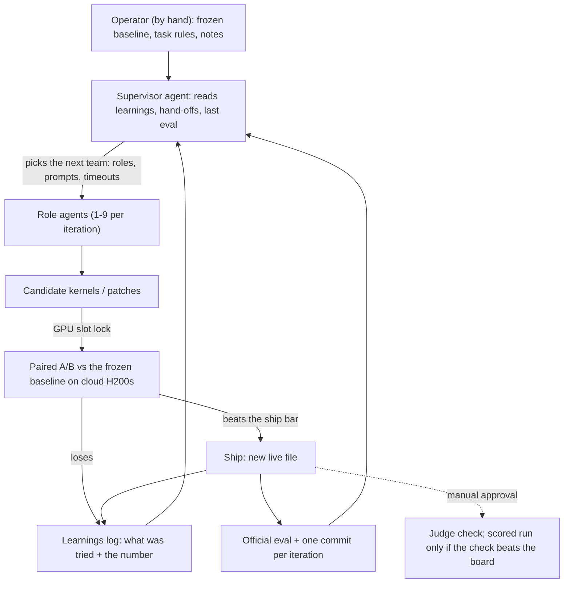

# Autoresearch setup

Long unattended optimization loops run by AI agents (Claude Code, mostly Opus 5.5), adapted from
[caoshiyi/EAT](https://github.com/caoshiyi/EAT) (Evolving Agent Teams, Apache-2.0).

## Components

| Component | What it does |
|---|---|
| Supervisor loop | Persistent agent session that plans each iteration's team; one commit per iteration with its score |
| Role agents | Headless Claude Code sessions, each with its own scratch folder and a hand-off note |
| Task rules | Fixed requirements pasted into every agent prompt: score, files, resources, honesty, shipping |
| Frozen baseline | The incumbent file and its judge score, fixed for the whole run |
| Eval harness | Paired A/B of candidate vs baseline on cloud H200s; score = baseline judge score x ratio; 0 on any failure |
| GPU backends | Modal H200, Nebius spot H200 (single GPU and 8 x H200), with Modal as fallback |
| GPU slot lock | Caps how many evals run at once across all loops; every GPU command logged |
| Prechecks | Readable source, size cap, imports, attribution markers; serving: lossless lint and per-run file ownership |
| Knowledge store | Append-only learnings, agent reports and hand-offs carried across iterations and runs |
| Operator notes | Channel from operator to supervisor: judge results, rule changes, deadlines |
| Judge queue | Agents can't reach the judge; candidates go to a queue that the operator approves |
| Serving cost model | Amdahl model of the judge's serving time, to rank what to speed up next |
| Dashboard | Live judge results, loop progress, version lineage, costs |
| Host | A 128-core Linux server runs the loops; all timing on cloud H200s |

## Eval harness

| Target | Correctness | Timing | Noise floor (A/A) |
|---|---|---|---|
| decode_layer | 13 tests + 12 scored shapes x 2 seeds, nearby shapes, graph replay | Cold-L2 graph replay, both orders, 2 seeds, 30 reps | 1.0002 |
| moe_w4a16 | 5 tests + 6 shapes x 4 seeds, 27 nearby sizes, skewed / hot / empty routing | 8 routing seeds in 2 groups, both orders, 40 reps | 0.9998 |
| bf16_proj | 9 tests + 30 shapes, nearby sizes, outliers | 4 prepared states in ABBA order, 4 seeds | 0.9986 |
| attention_decode | 16 tests + 12 shapes, nearby batch / context, page sizes | Fresh random-padded states per cell, rotated orders | 1.0006 |
| prefill_layer | 5 tests + 8 shapes, 20 nearby cases, judge-like routing | 4 ABBA states, 8 seeds, 30 reps | 0.9997 |
| Serving, per-phase runs | Bitwise or tolerance gates against stock SGLang | Paired cold-L2 timing of one phase (prefill, draft, verify, host) | 0.9995-1.0005 |
| Serving, 8 x H200 runs | Full served loop, judge-like conversations | Paired sessions, throughput or first-turn time | within 0.14% |

## Roles

| Role | Job |
|---|---|
| Operator (by hand) | Sets up the run, freezes the baseline, extends or pauses it, approves every judge call |
| Prep agent | Builds a new run: problem folder, eval, gates, A/A and control runs |
| Supervisor | Can't edit files; reviews the last team and writes the next team's plan |
| Solo optimizer | First iteration: maps the problem and makes the first ship attempt |
| Scout | Reads reports, profiles and public repos; turns them into testable ideas |
| Architect | Designs a kernel or schedule on CPU (SASS, registers) before using GPU time |
| Engineer | Builds one lever behind a flag and screens it on GPU |
| Integrator | Merges passing levers, re-runs the full A/B, ships |
| Gap analyst | Measures each phase against its hardware floor |
| Auditor / critic | Checks eval bias, gate holes, licences and eval-vs-judge gaps |
| Ablator | Prices each part of a stack by removing it |
| Measurer | Owns the GPU in 8-GPU runs and runs paired sessions for the others |
| Byte trimmer | Shrinks the patch under the size cap with no behaviour change |
| Night operator | Overnight session: starts staged runs, pauses on caps, writes a morning report |

## Runs

Dates EST. Kernel start -> end = judge scores; serving = the run's own eval score (A1-A3 and B vs stock SGLang, others vs the run's start = 1.0).

| Run | Target | Dates | Iters | Agents | Files | Evals | Ships | Start -> end | Outcome |
|---|---|---|---|---|---|---|---|---|---|
| decode 1 | decode_layer | 11-02 - 11-03 | 6 | 16 | 40 | 56 | 1 | 2.2685 -> 2.2869 | +0.34% eval |
| decode 2 | decode_layer | 11-03 | 6 | 16 | 115 | 49 | 0 | 2.2869 -> - | ~+0.1%, under the ship bar |
| decode 3 | decode_layer | 11-03 - 11-04 | 6 | 16 | 57 | 54 | 0 | 2.2933 -> - | Best stack +0.28%; not scored |
| decode 4 | decode_layer | 11-04 | 6 | 16 | 48 | 117 | 7 | 2.2933 -> 2.3326 | |
| decode 5 | decode_layer | 11-04 | 6 | 13 | 122 | 177 | 8 | 2.3261 -> 2.3368 | Re-roll 2.3443 |
| decode 6 | decode_layer | 11-04 - 11-05 | 4 | 10 | 25 | 27 | 2 | 2.3350 -> 2.3595 | Closing board row |
| MoE 1 | moe_w4a16 | 11-03 | 6 | 16 | 194 | 102 | 5 | 2.4034 -> 2.4410 | 7 -> 4 builds |
| MoE 2 | moe_w4a16 | 11-03 | 6 | 16 | 328 | 17 | 1 | 2.4410 -> 2.5056 | Board row |
| bf16 | bf16_proj | 11-03 | 6 | 16 | 129 | 139 | 13 | 1.5833 -> 1.5897 | Re-roll 1.6109 = board row |
| attention | attention_decode | 11-03 - 11-04 | 6 | 16 | 159 | 48 | 5 | 2.6810 -> 2.7165 | Re-roll 2.7344 = board row |
| prefill | prefill_layer | 11-03 - 11-04 | 6 | 16 | 134 | 50 | 5 | 1.9232 -> 1.9346 | Re-roll 1.9758 = board row |
| A1 | Serving prefill, old base | 11-04 | 2 | 4 | 64 | 24 | 4 | 2.012 -> 2.073 | Paused for the kernel close |
| A2 | Serving prefill, new base | 11-10 | 3 | 7 | 45 | 38 | 4 | 2.1715 -> 2.1800 | Day-1 check patch |
| A3 | Serving prefill, lossless rules | 11-12 - 11-13 | 9 | 24 | 241 | 37 | 5 | 1.9217 -> 1.9789 | Day-2 patch |
| B | Prefill glue / GEMM | 11-13 | 6 | 16 | 61 | 26 | 1 | 1.9809 -> 1.9828 | Cleanup only |
| C | Draft step | 11-13 | 6 | 15 | 112 | 145 | 8 | 1.0 -> 1.1179 | |
| D | Verify step | 11-13 - 11-14 | 11 | 29 | 240 | 293 | 8 | 1.0 -> 1.0933 | +9.7% on a plain KV pool = +6.1% on the judge's |
| D2 | Verify, judge's KV pool | 11-14 | 11 | 30 | 140 | 121 | 2 | 1.0 -> 1.0413 | |
| E | Prefill row slicing | 11-14 - 11-15 | 10 | 26 | 46 | 38 | 1 | 1.0 -> 1.0033 | No speed ship |
| F | Served loop, 1-GPU rig | 11-14 - 11-15 | 6 | 16 | 15 | 41 | 1 | 1.0 -> 1.0043 | Flags broke a TTFT gate |
| G | Small prefill forwards | 11-15 | 8 | 27 | 47 | 36 | 3 | 1.0 -> 1.0189 | ~+0.1% judge time |
| D3 | Verify step, order-only | 11-15 - 11-16 | 8 | 27 | 176 | 151 | 2 | 1.0 -> 1.0100 | |
| H | Host time | 11-15 - 11-16 | 6 | 16 | 25 | 23 | 0 | 1.0 -> 1.0014 | Under the bar; closed |
| T | Cross-GPU comm, 8 x H200 | 11-15 - 11-16 | 8 | 29 | 49 | 47 | 1 | - | Transport in the 11-16 scored patch |
| Z | Patch size diet | 11-15 - 11-16 | 6 | 21 | 223 | 87 | 7 | 1.0 -> 1.4045 | 40,450 B cut |
| P | First turn -> final hill climb | 11-16 - 11-20 | 57 | 244 | 341 | 117 | 27 | - | 3.0097, 3.0221, 3.0811 board files |
| V | Verify attention | 11-17 | 6 | 17 | 104 | 116 | 17 | 1.0 -> 1.0499 | Kernel carried into run P |
| X | Later turns, 8 x H200 | 11-17 | 6 | 16 | 29 | 15 | 0 | - | GPU-bound; closed |
| **Total** | 28 runs | 11-02 - 11-20 | **233** | **731** | **3,309** | | **138** | | |

## Guardrails

| Rule | Why |
|---|---|
| No judge access for agents | The judge quota is small; every check and scored run approved by hand |
| Check first, score only above the board | Scored runs land ~0.3% under their check on average |
| Learning over score (serving) | Every ship or reject records what was learned and the number |
| GPU caps | Shared account limits; 8-GPU sessions get priority |
| Nebius first, Modal fallback | Modal H200 shortages queued evals for hours |
| Timeout + grace period | Hard kills lost unshipped work |
| Pause between iterations | Soft stop; overnight runs stop on their own by morning |
| Frozen baseline | No baseline change mid-run |
| Readable-source and size checks | Competition rules: no encoded source, size caps |
| Lossless lint, file ownership | Serving rules are lossless; parallel runs own separate files |
| Licence rule | Only Apache-2.0 / MIT code, attributed, every change marked and behind a flag |
| Honesty rules | No special-casing of seeds or shapes, no output caching, no timing tricks |

## Other agent work

| Work | What |
|---|---|
| Public-repo sweeps | Twelve sweeps of GitHub and other platforms; found the public bases credited in [README.md](README.md) |
| Fork and repo reviews | Competitor forks and public submissions, read for ideas and licences |
| Subagent probes | One-off measurements, audits, soak tests and rig builds |
| Judge calibration | Judge vs cloud timing; the judge pool (21 nodes, 4 clusters) showed no thermal effect |
| Dashboard | Judge results, loop progress, lineage, cost and rank history |

## Lessons

- Tiny kernels need 4 prepared states in ABBA order: a two-state A/A of the same file read 1.0050.
- Copy the judge's real config into the eval first: run D's +9.7% was +6.1% on the judge's KV pool.
- An eval win isn't a judge win: a +2.9% per-layer gain left the judge's first-turn time unchanged.
- One judge roll moves 1-2%: re-rolling the same final added +0.7% (attention) and +2.1% (prefill).
- Hard kills lose work; a timeout plus grace period keeps ships and hand-offs.
- Short small-lever runs (E, H, X) mostly closed lanes; the long run P produced every serving board file from 3.0097 up.
- The loops paid off from the first night: MoE +1.6% scored, decode +0.8%.
