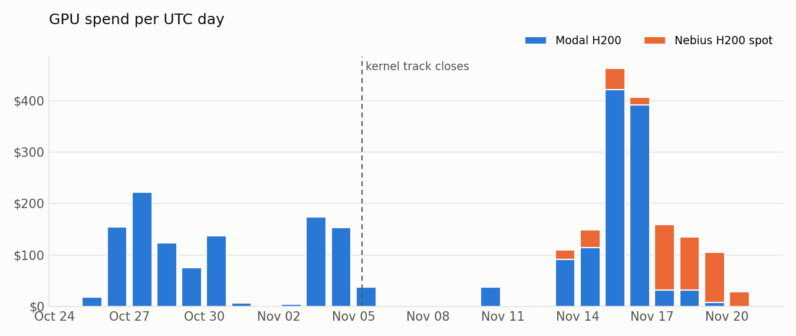
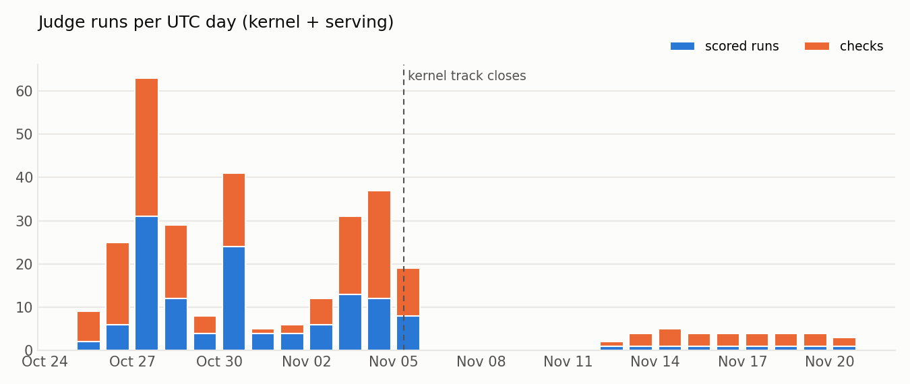
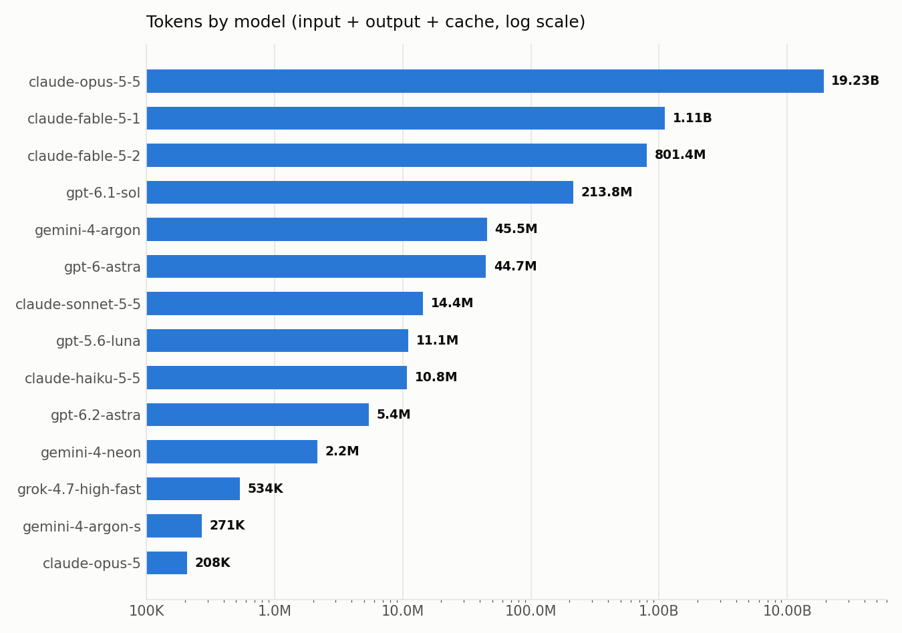

# Cost

## GPUs

| | Kernel track | Serving track | Total |
|---|---|---|---|
| Modal H200 | $1,040 | $1,208 | $2,248 |
| Nebius H200 (spot, estimated) | - | $463 | $463 |
| **Total** | **$1,040** | **$1,671** | **$2,711** |

| Modal, by problem | Cost | H200-hours |
|---|---|---|
| decode_layer | $420 | 86 |
| moe_w4a16 | $172 | 35 |
| prefill_layer | $150 | 31 |
| attention_decode | $142 | 28 |
| bf16_proj | $94 | 20 |
| Shared tools | $62 | 13 |
| Serving | $1,208 | 216 |
| **Total** | **$2,248** | **429** |

| Nebius H200 spot | Runs | Cost (estimated) |
|---|---|---|
| Serving | 764 | $463 |

## Judge usage

| | Scored runs | Checks |
|---|---|---|
| Kernel track | 126 | 160 |
| Serving track | 9 | 25 |

## LLM tokens (subscriptions, so tokens instead of dollars)

| | Kernel track | Serving track | Total |
|---|---|---|---|
| Sessions | 330 | 677 | 1,007 |
| Output tokens | 50.5M | 75.8M | 126.3M |
| All tokens (input + output + cache) | 8.79B | 12.71B | 21.49B |
| Cost at API list price (not billed) | $4,695 | $6,124 | $10,819 |

