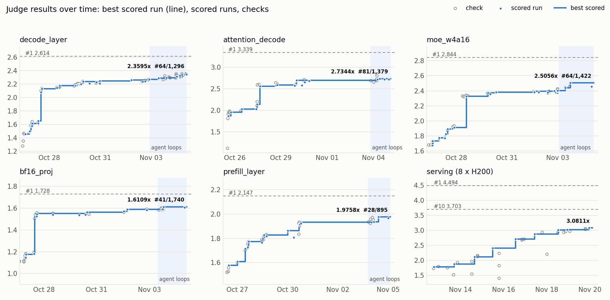
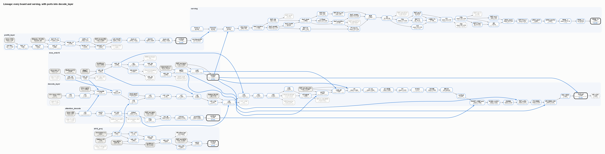

# Open Kernel Challenge 2026 (Muse Spark): LDD19

Best submission on each of the five kernel boards and on the serving track.

| Track | Result |
|---|---|
| Kernel track (closed 2026-11-05) | #55 on the final overall board |
| Serving track (closed 2026-11-20) | **3.0811x** stock SGLang on 8 x H200, lossless |

| Doc | Contents |
|---|---|
| [decode_layer](kernel/decode_layer/README.md) · [attention_decode](kernel/attention_decode/README.md) · [moe_w4a16](kernel/moe_w4a16/README.md) · [bf16_proj](kernel/bf16_proj/README.md) · [prefill_layer](kernel/prefill_layer/README.md) | Per-board score history, attempts, dead ends |
| [serving](serving/README.md) | Serving score history, attempts, dead ends |
| [AUTORESEARCH.md](AUTORESEARCH.md) | Agent-loop setup: harness, roles, runs, guardrails |
| [NOTES.md](NOTES.md) | Rules and context |
| [COST.md](COST.md) | GPU spend, judge usage, LLM tokens by model |

## Lineage

| Box | Meaning |
|---|---|
| Blue border | Own version |
| Gray fill | Public file or external code it builds on |
| Dashed | Candidate that never became a board entry |
| Faded | Retired branch |
| Thick black border, BOARD | Final board entry |
| Thick blue arrow | Piece ported from another board into decode_layer or serving |

## Kernel track

One H200, each problem scored as speedup over the reference implementation.

| Board | Speedup | Rank | Top % | Board leader |
|---|---|---|---|---|
| [decode_layer](kernel/decode_layer/) | **2.3595x** | 64 / 1,296 | 4.9% | 2.614 |
| [attention_decode](kernel/attention_decode/) | **2.7344x** | 81 / 1,379 | 5.9% | 3.339 |
| [moe_w4a16](kernel/moe_w4a16/) | **2.5056x** | 64 / 1,422 | 4.5% | 2.844 |
| [bf16_proj](kernel/bf16_proj/) | **1.6109x** | 41 / 1,740 | 2.3% | 1.728 |
| [prefill_layer](kernel/prefill_layer/) | **1.9758x** | 28 / 895 | 3.1% | 2.147 |

| | Count |
|---|---|
| Scored runs | 126 |
| Judge checks | 160 |
| Best rank held during the track | decode #30, attention #32, moe #47, bf16 #25, prefill #23 |

## Serving track

A patch to SGLang for Muse Spark Open 816B-A42B NVFP4 with the DFlash2 drafter, TP8 = EP8 on 8 x H200. Scored over
1 / 4 / 16 / 32 concurrent users on 13-turn agentic conversations (first turn ~74K tokens).

- [`serving/README.md`](serving/README.md): score history and attempts
- [`serving/FINAL_3r.diff`](serving/FINAL_3r.diff): the patch (`git apply` on SGLang `297e54fd`)
- [`serving/FINAL_3r.notes.md`](serving/FINAL_3r.notes.md): reviewer notes
- [`serving/flags`](serving/flags): launch flags

### Final score

| Users | vs stock | tok/s/GPU | Stock tok/s/GPU | Accepted tokens / step |
|---|---|---|---|---|
| 1 | 3.106x | 19,789 | 6,371 | 4.0 |
| 4 | 3.094x | 30,402 | 9,826 | 3.8 |
| 16 | 3.099x | 38,185 | 12,323 | 4.0 |
| 32 | 3.027x | 38,185 | 12,617 | 4.1 |
| **Score** | **3.0811x** | | | |

| Correctness gate | Result | Bound |
|---|---|---|
| Prefill KL mean | 0.053 | <= 0.11 |
| Decode KL mean | 0.012 | <= 0.035 |
| Prefill top-1 | 0.82 | >= 0.62 |
| Later-turn agreement | 0.95-0.97 | >= 0.92 |
| GPU memory vs stock | -2.2 GB | <= +2 GB |

### Scored runs

| Date (EST) | Score |
|---|---|
| 11-12 | 1.7884 |
| 11-13 | 1.8809 |
| 11-14 | 2.1149 |
| 11-15 | 2.4042 |
| 11-16 | 2.7146 |
| 11-17 | 2.8735 |
| 11-18 | 3.0097 |
| 11-18 | 3.0221 |
| 11-19 | **3.0811** |

9 scored runs and 25 checks.

### What the patch does

| Part | Class |
|---|---|
| Sequence-parallel prefill after attention (layers 0-60): o-proj reduce-scatter, norms, router, pooler, experts, unpooler on T/8 rows per rank | order-only |
| Hopper NVFP4 expert kernel (W4A16, stock's Hopper form) | stock's math; <= 1 bf16 ulp run to run |
| Copy-engine transports over CUDA IPC: next layer's qkv input, streamed attention output into o-proj, next layer's o weight | bitwise |
| Per-forward copies of hot experts on lightly loaded ranks (chunks >= 4,096 rows) | bitwise |
| Experts' reduce-scatter written by the expert kernel into the token owner's inbox, fixed ring-order sum | order-only |
| Last layer: only the rows the logits processor reads | skips unread rows |
| Verify: FA3-exact attention with another split plan, pinned cuBLASLt configs, fused kernels | split plan / bitwise |
| Drafter: fc on each rank's own tap rows, drafter GEMM / top-k kernels | bitwise |
| Flags: `--swa-full-tokens-ratio 0.25`, `--hicache-size 120`, prefill delayer (0.375, 6 passes), `--prefill-max-requests 32` | stock options |

## Credits and licenses

The kernel files build on public submissions from other competitors. Each file's header names its sources and marks my
changes with `LDD19:`.

| Board | Built on | License |
|---|---|---|
| decode_layer | [vjeux/okc-2026](https://github.com/vjeux/okc-2026); [chenwainuo/okc](https://github.com/chenwainuo/okc); [keell0renz/muse-open-kernel-challenge](https://github.com/keell0renz/muse-open-kernel-challenge); [Madhavan113/ParadigmKernelChallenge](https://github.com/Madhavan113/ParadigmKernelChallenge); [NathenFernandes/muse-bf16-proj](https://github.com/NathenFernandes/muse-bf16-proj) | Apache-2.0, MIT (Nathen) |
| attention_decode | [vjeux/okc-2026](https://github.com/vjeux/okc-2026) | Apache-2.0 |
| moe_w4a16 | [vjeux/okc-2026](https://github.com/vjeux/okc-2026); [keell0renz/muse-open-kernel-challenge](https://github.com/keell0renz/muse-open-kernel-challenge); [Madhavan113/ParadigmKernelChallenge](https://github.com/Madhavan113/ParadigmKernelChallenge) | Apache-2.0 |
| bf16_proj | [NathenFernandes/muse-bf16-proj](https://github.com/NathenFernandes/muse-bf16-proj); [vjeux/okc-2026](https://github.com/vjeux/okc-2026); [chenwainuo/okc](https://github.com/chenwainuo/okc); [keell0renz/muse-open-kernel-challenge](https://github.com/keell0renz/muse-open-kernel-challenge) | MIT (Nathen), Apache-2.0 |
| prefill_layer | [vjeux/okc-2026](https://github.com/vjeux/okc-2026); [ZhimaoL/sglang](https://github.com/ZhimaoL/sglang) | Apache-2.0 |
| serving | [sgl-project/sglang](https://github.com/sgl-project/sglang) | Apache-2.0 |
