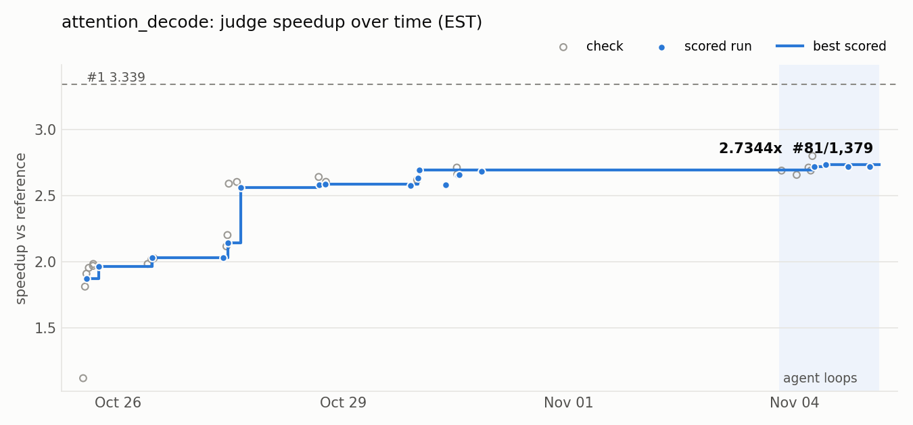
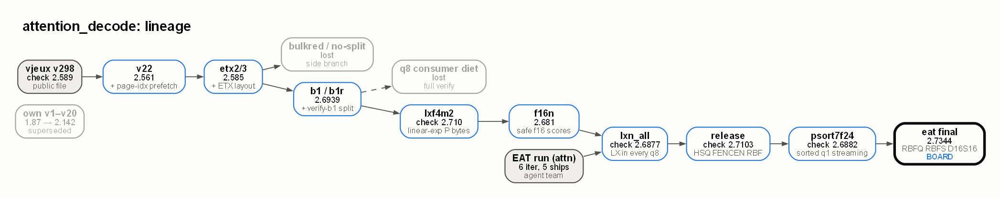

# attention_decode

| Metric | Value |
|---|---|
| Final speedup | **2.7344x** |
| Final rank | 81 of 1,379 (top 5.9%) |
| Best rank held during the track | #32 |
| Board leader | 3.339x |
| Scored runs / checks | 19 / 24 |
| Final file | re-roll of the EAT attention run's final |
| EAT | Evolving Agent Teams: autonomous agent loop (method from caoshiyi/EAT, Apache-2.0), paired H200 A/B as ship gate; 6 iterations, 5 ships |

## Score history

| Date (UTC) | Version | Judge (scored unless "check") | What changed |
|---|---|---|---|
| 2026-10-25 | own v1 | 1.1188 check | Triton split-K kernel + combine kernel |
| 2026-10-25 | own v2-v3 | 1.8107 check | new-token work moved into chunk 0, in-kernel merge, per-shape `pick_tune` |
| 2026-10-25 | own v4 | 1.9083 check / 1.8714 | first scored run: in-kernel RoPE (Cody-Waite reduction + SFU) replaces a 512 MB table |
| 2026-10-25 | own v5 | 1.9527 check | CUDA split kernel for full-attention decode |
| 2026-10-25 | own v6 | 1.9821 check / 1.9611 | batch 1: new tokens get their own program (`newslot`) |
| 2026-10-26 | own v17 | 2.0171 check / 2.0301 | page entries issued before query work, fewer sliding-verify chunks |
| 2026-10-27 | own v18 | 2.0255 check / 2.0292 | FP8 QK^T on sliding layers too |
| 2026-10-27 | own v19 | 2.1152 check | static softmax anchor (no running max), batch-16 one-wave fix |
| 2026-10-27 | own v20 | 2.2004 check / 2.1419 | batch-1 full-decode kernel `attn_b1`, smem bank-conflict fix; rank 111; last own-base row |
| 2026-10-27 | vjeux v298, unmodified | 2.5888 check | public Apache-2.0 file, faster than v20 on 11 of 12 shapes |
| 2026-10-27 | v22 | 2.6017 check / 2.5610 | switched base to v298 + page-index L2 prefetch (PFD) + sliding decode 16 at 8 splits; rank 43 |
| 2026-10-28 | etx2 | 2.6394 check / 2.5812 | ETX: aligned 32-tile layout for the verify-sliding window |
| 2026-10-28 | etx3 | 2.5851 | ETX with tile 0 peeled at compile time |
| 2026-10-28 | crumb1 | 2.6026 check | QK^T scale fold in the flat q8 kernel; not scored |
| 2026-10-30 | etx2r | 2.5744 | re-roll of etx2 |
| 2026-10-30 | b1 | 2.6175 check / 2.6303 | head split of the verify-1-sliding grid (33 -> 66 CTAs) |
| 2026-10-30 | b1r | 2.6939 | same code re-rolled: **#32 of 1,103, best rank held** |
| 2026-10-30 | b1r2 | 2.5791 | second re-roll |
| 2026-10-30 | lx4m2 | 2.6587 check | f16 QK^T accumulation; rejected (NaN on 100x-RMS keys) |
| 2026-10-30 | lxf4m2 / lxf4m2r | 2.7103 check / 2.6510 / 2.6542 | linear-exp e4m3 P bytes in the flat q8 consumer (MUFU exps 32 -> 0) |
| 2026-10-31 | f16n | 2.6810 | safe f16 scores with f32 fallback + merge guard |
| 2026-11-04 | EAT iter 1: lxn_all | 2.6877 check | linear-exp consumer in every per-request q_len 8 instance |
| 2026-11-04 | EAT: b_f1 | 2.6552 check | race fix candidate, not shipped (fix kept as FENCEN) |
| 2026-11-04 | EAT iter 5: release | 2.7103 check | HSQ, FENCEN, BF16 merge reds (RBF) |
| 2026-11-04 | EAT iter 6: psort7f24 | 2.6882 check | q_len 1 flat producer streams old tiles in physical-row bucket order |
| 2026-11-04 | EAT final | 2.7978 check / 2.7165 | + RBF_D1, RBFQ, RBFS, sliding decode 16 back at 16 splits |
| 2026-11-04 | EAT final, re-roll 1 | **2.7344** | same code + one comment: board row, rank 71 of 1,344 |
| 2026-11-04 | EAT final, re-roll 2 | 2.7157 | under the row |
| 2026-11-05 | EAT final, re-roll 3 | 2.7166 | under the row |

## What's in the final file

| Component | Since | Source |
|---|---|---|
| One fused CUDA kernel per call: QK-norm, RoPE, FP8 cache write, split-KV attention, fixed-reference FP32 merge, RMSNorm * sigmoid(gate) | v22 | vjeux/okc-2026 v298 (Apache-2.0) |
| Flat grid for batched full layers (264 CTAs, producer warpgroup, `setmaxnreg`), FP8 QK^T + FP8 PV on q_len 8, TMA page-index loads, seq_len speculation | v22 | vjeux v298 |
| LDD_PFD: L2 prefetch of page indices 4 tiles ahead in the q8 flat producer | v22 | own |
| ETX aligned 32-tile verify-sliding layout, older keys as a separate instance | etx2 | own |
| B1SPLIT head split of the verify-1-sliding grid | b1 | own |
| LX: P byte = e4m3 code of a piecewise-linear 2^(x+4), f32 S, merge x2^-4 | lxf4m2 | own |
| f16 scores while row offsets stay in range, warp-uniform f32 fallback, merge guard | f16n | own |
| LXN: LX consumer in every per-request q_len 8 instance | EAT iter 1 | own |
| HSQ: head-split CTA stages and normalizes only its own head's queries | EAT iter 5 | own |
| FENCEN: fence + warpgroup barrier before the PV wgmma (formal race fix) | EAT iter 5 | own |
| RBF / RBF_D1 / RBFQ / RBFS: BF16 merge partials, one 16-B `red.v4.bf16x2` per 8 dims instead of 4 FP32 dims | EAT iter 5-6 | own (BF16 partials allowed by organisers 2026-11-03) |
| PSORT 7: old tiles streamed in physical-row bucket order, all CTAs sweeping the pool in step | EAT iter 6 | own |

## What worked

| Lever | Measured gain (paired H200 A/B unless "judge") |
|---|---|
| New-token work into chunk 0 (own) | verify sliding 0.6x -> 1.6-2.9x |
| In-kernel RoPE (own v4) | judge check 1.81 -> 1.91 |
| CUDA full-decode split kernel (own v5) | judge check 1.91 -> 1.95; 3.4 TB/s on the judge |
| Static softmax anchor + batch-16 wave fix (own v19) | 2.154 / 2.158 vs 2.084 / 2.076; full verify 32 judge 281 -> 267.5 us |
| `attn_b1` + bank-conflict fix (own v20) | judge check 2.115 -> 2.200; batch-1 full decode 15.3 -> 13.9 us |
| Switch to vjeux v298 | judge 2.142 scored -> 2.589 check |
| Page-index L2 prefetch (PFD) | verify 16 -1.0..-1.9 us, verify 32 -0.3..-1.5 us, ~+0.008 |
| Sliding decode 16 at 8 splits | -0.48 us, ~+0.005 (reverted to 16 in the final) |
| ETX | -0.3 us verify 16 sliding, -0.1 us verify 32 sliding |
| B1SPLIT | -0.25..-0.35 us verify 1 sliding |
| LX linear exp | verify 32 full -5.66 us, verify 16 full -4.02 us; judge verify 16/32 full ~100 / ~183 -> 93.4-95.1 / 171.1-175.3 us |
| f16n | +0.06 / +0.61 us on verify 32 / 16 full vs lxf4m2 |
| LXN | 1.0089 / 1.0070 vs f16n (verify 1 full 1.051, verify 32 sliding 1.080) |
| HSQ + FENCEN + RBF | 1.0072 / 1.0041 |
| PSORT | 1.0060 / 1.0071; decode 16 full 1.022 / 1.026, decode 32 full 1.024 / 1.031 |
| RBF_D1 + RBFQ + RBFS + 16 splits | 1.0138 / 1.0117 cumulative vs the iteration-5 file |

## Dead ends

| Idea | Result |
|---|---|
| Triton full layers: `maxnreg` caps, `warp_specialize`, `block_n=256`, 8 warps, more splits at batch 1 | spills or slower; stuck at ~3.1 TB/s |
| CUDA `mma.sync` full verify | 452 vs 270 us at batch 32 (issue-bound) |
| Gluon warp-specialized full verify | 273-275 us, parity with Triton |
| CUDA sliding kernel | decode 16 13.7 vs 13.0 us, verify 32 25.3 vs 23.5 us |
| In-kernel last-arriver merge at batch 1 | loses 3-13 us; release + ticket ~1.2 us |
| Pure-gather "3.5 TB/s ceiling" probe | wrong: v298 reads the same random rows at 3.95 TB/s |
| FP16 PV instead of FP8 on the public base | +24-28% on full verify, -6.6% overall |
| Batch-1 sweeps on v298 (copies, coop, 17 splits, clusters, tagged slots, smem-staged reds, FP8 QK^T at q_len 1) | nothing beats the base |
| Clusters / per-row TMA / DYN on sliding 16/32 | worse; per-row TMA +2-5 us, DYN +10 us |
| W0ENABLE pair balancing, 1 CTA/SM, FMA-pipe exp2 on q8 verify | +2-3 us, +15/+33 us, +1..+19 us |
| Lean push-DSMEM cluster epilogue at batch 1 | 8.45 vs 6.2-6.6 us |
| Flat-kernel prologue/finalize fixes | per-request wait +2.4..3.5 us, thread-0 partition spills (+35%) |
| Static smem, smaller Params, page-table-tail L2 prefetch | noise or delays the index load (+0.001 total) |
| Madhavan113 probes (PIPE8, EXH8F, PFL2, WSMINB1, CPHINT) | all lose or tie; PFL2 doubles DRAM requests; CPHINT crashes |
| Per-request sorted page tables (host probe) | within 0.5% of random |
| No-split batched sliding decode | 8.70 / 11.97 us vs 8.54 / 9.81 us |
| TMA bulk-reduce merge (Madhavan113 OKC_BULKRED) | +0.26..0.38 us everywhere |
| Head split on decode 1 sliding, 4-way split | +0.19 us, +0.28 us |
| q8 consumer diet (exps on FMA pipe, STSM, deferred PV wait) | exps on FMA pipe lose 9.8 / 28.5 us; STSM noise; deferred PV fails ptxas (C7514/C7512) |
| QK^T scale fold (crumb1) | -0.45 us, error rises 0.085 -> 0.125 of a 0.15 bound |
| f16 QK^T accumulation without fallback (lx4m2) | NaN on 100x-RMS keys |
| VP2 16-owner DSMEM merge at verify 1 sliding | -0.19 / -0.54 us, cluster front end costs +0.73-0.80 us |
| Deferred PV overlap on f16 registers | +0.03..+0.49 us, noise |

## Lessons

- A public file at 2.589 beat three days of own kernels (2.142) on 11 of 12 shapes; switching was the biggest single step.
- Same code rolls widely on the judge: v22/etx family 2.561-2.639, b1 2.579-2.694; one node ran ~2% fast.
- A probe's own issue pattern can pose as a hardware ceiling (3.5 TB/s "limit" vs 3.95 TB/s reached).
- Host-sorted page tables did nothing; all CTAs sweeping the pool in step (PSORT) paid 2.2-3.1% on full decode 16/32.
- The batch-1 merge handoff (~1.1 us) is at its floor; every cluster merge lost to the launch cost.
- The q8 kernel is register-bound: any stack use costs +1..35%, and guarded code in the hot loop costs 0.6-1.1 us untaken.
