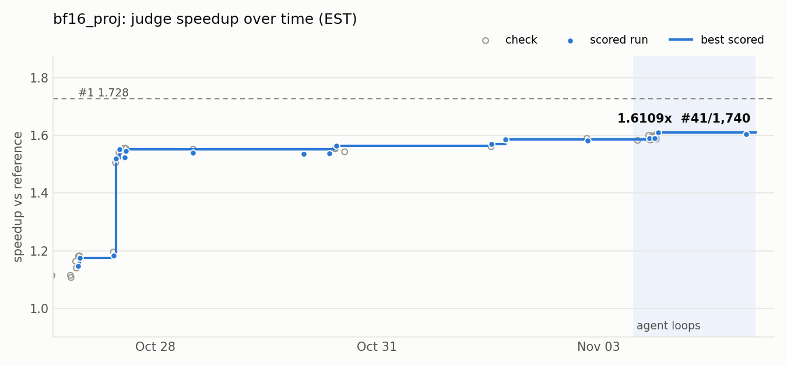
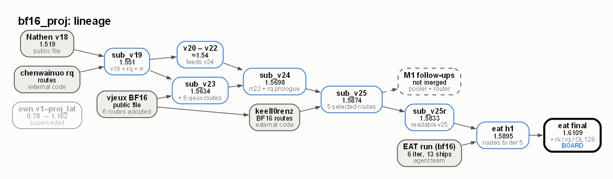

# bf16_proj

| Metric | Value |
|---|---|
| Final speedup | **1.6109x** |
| Final rank | 41 of 1,740 (top 2.3%) |
| Best rank held during the track | #25 (final re-roll, 2026-11-04) |
| Board leader | 1.728x |
| Scored runs / checks | 18 / 32 |
| Final file | re-roll of the EAT bf16 final |
| EAT | Evolving Agent Teams: autonomous agent loop (method from caoshiyi/EAT, Apache-2.0), paired H200 A/B as ship gate |

## Score history

"check" = unscored judge run, "scored" = counted run; bold = new best scored row. m = tokens per call.

| Date (UTC) | Version | Judge | What changed |
|---|---|---|---|
| 2026-10-25 | v1 | check 0.7789 | Triton split-K, swap-AB |
| 2026-10-26 | v6 | check 1.0889 | TMA ring + wgmma for m ≤ 32, cuBLAS for m ≥ 128, router fused as one GEMM |
| 2026-10-26 | cross-run tuning | check 1.0477 | a day of tuning by comparing separate Modal runs: a regression |
| 2026-10-26 | x box | check 1.0918 | x via one TMA box in the register-streaming kernel |
| 2026-10-26 | proj_tms | check 1.1048 | mma.sync consumer on the TMA ring (qkv m8/m16, o m8) |
| 2026-10-26 | router cluster | check 1.1094 | router m32 on a 16-CTA cluster |
| 2026-10-26 | pruned | check 1.1143 | unused instantiations dropped (build time) |
| 2026-10-27 | plan v2 | checks 1.1147, 1.1068 | 12-bit register stream on the pooler at m ≤ 8 |
| 2026-10-27 | plan v3 (proj_tmr) | checks 1.1632, 1.1398; scored **1.1468** | 12-bit compressed TMA ring + RS wgmma on every pooler bucket and unpooler m16/32 |
| 2026-10-27 | qkv on proj_tmr | check 1.1807 | qkv m1-32 on proj_tmr, uneven 3-way K split (108 CTAs) |
| 2026-10-27 | fixed-cost trims | check 1.1823, scored **1.1745** | `prefetch.tensormap`, register-fragment push (-0.2..-0.6 us per shape) |
| 2026-10-27 | proj_lat | check 1.1955, scored **1.1821** | latency kernels on unpooler m1/m8, router m1/m16/m32; last own-kernel row |
| 2026-10-27 | Nathen v18 (public) | check 1.5055, scored **1.5195** | public MIT file, attribution header only; replaced the own line |
| 2026-10-27 | v19 | check 1.5411, scored **1.5515** | dead v18 builds pruned + chenwainuo rq on qkv/pooler/unpooler m32 and qkv/pooler m128 + rr router m1 + unpooler m128 Lt pin; rank 27 |
| 2026-10-27 | v20 | check 1.5564, scored 1.5244 | + unpooler m128 on rq |
| 2026-10-27 | v21 | check 1.5544, scored 1.5458 | + EARLY + RG prologue on the three m128 rq routes |
| 2026-10-28 | v22 | check 1.5525, scored 1.5394 | + router m128 on own rr22 kernel |
| 2026-10-30 | v19 re-rolls | scored 1.5354, 1.5389 | same code + one comment |
| 2026-10-30 | v23 | check 1.5538, scored **1.5634** | v19 + 6 vjeux routes: cgemv qkv/unpooler m1, sk2 pooler/unpooler m32 and qkv m16, rk router m256 |
| 2026-11-01 | v24 | check 1.5615, scored **1.5698** | + rr22 router m128 + EARLY/RG on qkv/pooler m128 |
| 2026-11-01 | v25 | scored **1.5874** | + 5 routes picked cell by cell from the keell0renz dispatcher; source was compressed, so the row was later removed |
| 2026-11-03 | v25r | check 1.5901, scored 1.5833 | readable v25: plain-text sources, 757 KB of unreachable code removed, kernels unchanged |
| 2026-11-03 | EAT iteration 2 | check 1.5831 | m=1 cgemv routes, router hi+lo cgemv, router m8/m32 routertail |
| 2026-11-03 | eat h1 (iteration 5) | check 1.6007, scored **1.5895** | + o m16 sk2 + escape-warp early release, unpooler m8 RED3, compile-time-m plans, router m16 compile-time m |
| 2026-11-03 | iteration 6 steps | checks 1.5850, 1.5855, 1.5994 | iteration-5 final, + qkv m32 cursor rq, mid-iteration file |
| 2026-11-03 | eat final | checks 1.5958, 1.6037; scored 1.5897 | + o m128 BK64 x 8 stages, router m32 S16 WK4, rk m256 ring 8, qkv m32 cursor-escape rq, rq m128 EARLY, router m128 on rk, unpooler m16 WR1 |
| 2026-11-03 | h1 re-roll | check 1.5872 | same code as h1 |
| 2026-11-04 | final re-roll | scored **1.6109** | same code + one comment; the 1.5897 run was an SGLang-side roll |
| 2026-11-05 | final re-roll 2 | scored 1.6047 | same code + one comment |

## What's in the final file

| Component | Source |
|---|---|
| Base: 12-bit lossless weight format (low 8 bits + 3-bit exponent offset + sign, escapes restored exactly), register-streaming small-m kernels (smtrace, cpssm, v18s_gemv), routertail router kernels, ol_projection for o, pinned cuBLASLt plans at m = 256 | NathenFernandes/muse-bf16-proj v18 (MIT) |
| Dead v18 builds pruned (cold prepare 86 -> 41 s on Modal) | own (v19) |
| rq split-K register-A wgmma kernel (qkv m32, qkv/pooler/unpooler m128), its 12-bit pack/escape helpers, rr FP32 router, unpooler m128 cuBLASLt pick | chenwainuo/okc (Apache-2.0) |
| Cursor-escape + EARLY rq variant at qkv m32 and m128 | chenwainuo backend source via keell0renz (Apache-2.0), routed by EAT |
| gv qkv m8, o m256 Lt plan (tile20 / custom6 / cluster2), primary CUDA-context bind | keell0renz dispatcher (Apache-2.0); Lt pins credit alygg77 and Matsvei |
| cgemv (qkv / pooler / o / unpooler slice at m=1), sk2 (pooler / unpooler m32, qkv m16, o m16 / m32), rk router (m128 K split 16, m256), packing helpers | vjeux/okc-2026 (Apache-2.0) |
| sk2 config u32_r96 for unpooler m32; independent cgemv accumulators | alygg77 (Apache-2.0) |
| cgemv_hl: router m=1 as two 12-bit planes (BF16 hi + lo) with FP32 accumulation | own derivative of vjeux's cgemv |
| Router routertail retunes: m8 S8 WK8, m16 compile-time m, m32 S16 WK4; rk m256 ring depth 8 | own (EAT) |
| sk2 escape-warp early slot release (EARLYREL) | own (EAT) |
| unpooler m8 RED3 (in-CTA K reduce before the cluster push), compile-time-m plans for o m8 and pooler / unpooler m16, o m128 on BK 64 x 8 stages | own (EAT) |
| rr22 router m128 (8 row tiles x 16 K slices, whole-slice burst, hi+lo summed in registers) | own; kept behind a switch, replaced by rk at m128 in the last iteration |
| Per-route validation in prepare (one-hot columns bit-exact, random rows vs FP64); failed route falls back | own |
| Per-(layer, m) fixed routes; readable-source rebuild | own |
| EAT loop itself (supervisor session reorganizes up to 3 coding agents per iteration) | caoshiyi/EAT method (Apache-2.0), no kernel code |

## What worked

| Lever | Measured gain |
|---|---|
| TMA ring + wgmma instead of Triton | check 0.7789 -> 1.0889 |
| mma.sync consumer on the TMA ring | qkv m8 -2 us, m16 -1.3 us; judge 1.089 -> 1.105 |
| 12-bit compressed TMA ring + RS wgmma (proj_tmr) | pooler -2.1 us, unpooler m16/32 -1.7..-2.0 us; check 1.1632 |
| qkv on proj_tmr with 3-way K split | -0.4..-0.7 us at m ≤ 16, -3.2 us at m32 |
| Latency kernels (proj_lat) | -0.1..-1.6 us per shape |
| Switch to the v18 public base | scored 1.1821 -> 1.5195 |
| v19: pruning + chenwainuo rq routes | Modal 1.456 -> 1.482; scored 1.5515 |
| Unpooler m128 on rq (v20) | -0.67 us |
| EARLY + RG prologue on m128 rq (v21) | -0.35..-0.54 us per route |
| rr22 router m128 (v22) | -0.38..-0.45 us vs v18's kernel |
| 6 vjeux routes (v23) | Modal +1.21% vs 3 controls; prepare memory -55 MiB |
| rr22 + EARLY/RG merged onto v23 (v24) | full score +0.20..+0.27%, 36/36 cells |
| 5 keell0renz-selected routes (v25) | saved 0.200-1.308 us per cell, full score +0.880% |
| m=1 cgemv routes + cgemv_hl router (EAT 1) | 1.0035 vs v25r |
| Router m8 routertail S8 WK8 | 5.57 -> 5.36 us |
| o m16 sk2 + EARLYREL | 1.0064 vs v25r |
| Unpooler m8 RED3 | -0.13 us in-layer |
| Compile-time m (pooler / unpooler m16, o m8) | pooler16 1.0109 / 1.0135, unpooler16 1.0166 / 1.0189, o8 1.0079 / 1.0030 (two containers) |
| o m128 BK 64 x 8 stages | 8.07 -> 7.84 us |
| Router m32 S16 WK4 | 6.4 -> 6.0 us |
| rk m256 ring depth 6 -> 8 | 8.21 -> 7.99 us |
| qkv m32 cursor-escape rq | 11.68 -> 11.35 us |
| Router m128 on rk K split 16 | 7.01-7.12 -> 6.75-6.78 us |
| Unpooler m16 WR1 plan | 14.85 -> 14.75 us |
| Whole EAT run | eval 1.0087-1.0113 vs v25r; judge with SGLang held at its mean: 1.0119 |

## Dead ends

| Idea | Result / why it lost |
|---|---|
| Cross-run Modal comparisons for tuning | check fell to 1.0477; same-container A/B only after that |
| 12-bit weights on the mma.sync ring consumer (proj_tmz) | slower than bf16: pooler m1 24.0 vs 20.4 us; decode issue-bound |
| Router on the proj_tmr stream kernel | lost |
| Custom m = 128/256 GEMM (CuTe / hand PTX, split-K workspace, cluster multicast) | split-K exchange costs more than it saves; every library ties torch.mm within 2-6% |
| -2 us per router shape at m128 | not reachable: empty 128-CTA kernel 2.24-2.46 us, plain 8.4 MB read 4.7-4.9 us |
| Router: cluster-2 DSMEM pre-reduce, red.global.v4, token tiles, all-W-first | +0.05..+0.9 us |
| rq escape walk moved out of the math warps (6 designs) | +0.4..+2.4 us each |
| rq on o m128 / o m32 | +2 us / +0.7 us |
| rq retunes (qkv m128 KS6, half KS3, ST6/ST8) | +0.8 us, +3.6 us, neutral or worse |
| cp.async for the first rq stages | +0.2..+1.3 us |
| L2 prefetch of the first 5 rq stages | +2.2 us pooler m128, +0.9 us qkv m32 |
| Full keell0renz dispatcher, extra QKV / unpooler routes | tied or lost; only 5 cells kept |
| Exhaustive cuBLASLt search (1,584 plans per shape + split-K) | shipped pins already best (qkv256 18.56 vs 18.54 us) |
| 256 W rows per CTA (half the x traffic) | stream -1.4 us, reduce +2.5 us: 18.38 vs 18.29 us |
| x multicast in 2-CTA clusters (pooler / unpooler m128) | 18.71 -> 20.94 / 18.80 -> 20.89 us |
| Pair exchange of split-K partials through DSMEM | 20.2 / 19.8 us vs 18.71 / 18.80 |
| rq at m = 256 | pooler 27.5 vs 25.1 us, unpooler 28.0 vs 25.0 us |
| 12-bit router kernel (rt12) | escape loop +3.5 / +2.0 / +2.6 us at m8 / 16 / 32; ties BF16 even with no escapes |
| sk2 K split across a cluster (CL = 2/4) | -1.3..-3.8 us per shape |
| sk2 stage depth / NACC 2 / UPW 1 / more consumer warps | 0.73-0.996 |
| Producer warp applies sk2 escapes | pooler m32 15.9 -> 22 us |
| rq m128 ring depth ST3-ST8; W loaded straight to registers | 0.75-1.00; 0.86-0.93 |
| FFMA kernels to dodge the tensor-core clock drop | +1.3..+10 us at m8, +3..+75 us at m16/32 |
| Variable-length (~10.5-bit) weight codes | no published Hopper decoder reaches HBM rate; 12-bit fixed is the ceiling |

## Lessons

- Two public bases (v18, then vjeux routes) moved the score more than all own kernels: 1.1821 -> 1.5195 in one day.
- Same-code judge runs spanned 1.524-1.556 (v19-v22); single runs cannot resolve sub-1% gains.
- The headline also swings with SGLang's own per-shape times; holding SGLang at its mean over 26 runs made the judge agree with Modal.
- Small layers are launch-bound: launch + setup + exit alone is 2.3-2.7 us.
- The SM clock drops from 1.97 to ~1.75 GHz whenever tensor cores run; that ~1 us at rq m128 is not removable.
- The 1 MB source limit and the readable-source rule shaped the file: the readable rebuild had to prune unreachable code first.
