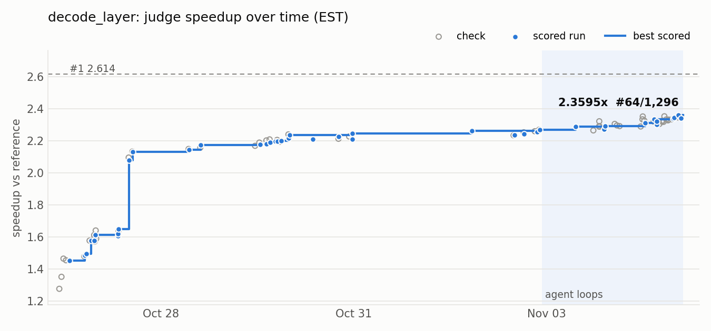
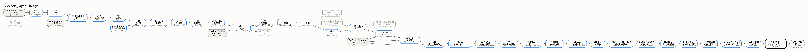

# decode_layer

| Metric | Value |
|---|---|
| Final speedup | **2.3595x** |
| Final rank | 64 of 1,296 (top 4.9%) |
| Best rank held during the track | #30 |
| Overall kernel board | #55 (overall rank follows decode_layer) |
| Board leader | 2.614x |
| Scored runs / checks | 41 / 58 |
| Final file | `stack_gt`, agent-loop run 6 |
| EAT | Evolving Agent Teams: autonomous agent loop (method from caoshiyi/EAT, Apache-2.0), paired H200 A/B as ship gate; runs 1-6 |

## Score history

| Date (UTC) | Version | Judge (scored unless "check") | What changed |
|---|---|---|---|
| 2026-10-26 | own, `moe_rows` | 1.276 check | CUDA dense GEMV + MoE kernels, warp per row block over all of K |
| 2026-10-26 | own, `moe_ks` | 1.351 check | 1-token expert kernel, cuBLAS above 16 tokens |
| 2026-10-26 | own, `moe_rows_xs` | 1.464 check | activations staged in shared memory |
| 2026-10-26 | own | 1.4529 | first scored run: FP32 router inside the pooler launch |
| 2026-10-27 | own | 1.4851 | tiled FP32 router, qkv handed to attention in FP32 |
| 2026-10-27 | own | 1.4943 | boundary kernel loads the residual before its PDL wait |
| 2026-10-27 | own | 1.5759 | XOR-encoded 8-op E2M1 dequant, 3-op scale conversion |
| 2026-10-27 | own | 1.5771 | `moe_ctas=8` above 128 tokens |
| 2026-10-27 | own, chain | 1.6136 | persistent post-attention chain at 4-8 tokens |
| 2026-10-27 | own, chain + compression | 1.6176 | + lossless 12-bit BF16 weight encoding |
| 2026-10-27 | own v6 | 1.6495 | + down-projection K split; rank 290 of 789; last own-base row |
| 2026-10-27 | vjeux v157e, unmodified | 2.0949 check | public Apache-2.0 file, faster than v6 on all 12 shapes |
| 2026-10-27 | v8 | 2.0783 | switched base to vjeux v157e + attribution header |
| 2026-10-27 | v10 | 2.1292 | cluster glue: both boundaries as 8-CTA clusters; rank 32 |
| 2026-10-28 | v11 | 2.1440 | one cluster reduction per boundary instead of two |
| 2026-10-28 | v12 | 2.1746 | vjeux m=1 cgemv, MoE WSH0, TINY FINPF, attention page-index prefetch, locked tuner picks |
| 2026-10-29 | v13 | 2.1682 check | MoE MAIN-prologue switches (MOEPRO); carried into v14 |
| 2026-10-29 | v14 | 2.1751 | rq kernel at T=128, pinned cuBLASLt at T=256, BF16 o above 32 tokens |
| 2026-10-29 | v15 | 2.1790 | DSMEM 2-CTA finish for MoE split units |
| 2026-10-29 | v16 / v16r | 2.1893 / 2.1952 | pinned cuBLASLt for combined FP32 pooler+router at T=128/256, CUDA route32, delayed gain load |
| 2026-10-30 | v17 | 2.1955 | PDL on four own-kernel edges at T=128 |
| 2026-10-30 | v18 | 2.1989 | KPERM3: K permuted per stage in the MAIN expert build |
| 2026-10-30 | v19 | 2.2166 | B4FIN expert final pass at M 17-32, cuBLASLt o pin at T=256 |
| 2026-10-30 | v19r | 2.2361 | same code re-rolled: **#30 of 1,011, best rank held** |
| 2026-10-31 | v20 | 2.2439 | attention synced to own attention entry, DQ3 dequant, OL128 o at T=128 |
| 2026-11-02 | v22 | 2.2614 | SC6 scale storage + per-expert MFIN completion (keell0renz); encoded source, later rebuilt readable |
| 2026-11-02 | v23 | 2.2360 | MID data-ready handoff at 9-16 tokens (keell0renz) |
| 2026-11-02 | v24 | 2.2422 | T=1 deferred first boundary (keell0renz) |
| 2026-11-03 | v24r | 2.2553 | v24 as readable source (no-encoded-source rule) |
| 2026-11-03 | v25 hybrid | 2.2685 | Keell pipeline at decode T 1/8/16/32 + verify T=8, v24r elsewhere, trimmed under 1 MB |
| 2026-11-03 | EAT run 1: f12 | 2.2869 | prepare diet, SIB2, GF(2) dq4 layout at T=8/16, FIN1/FIN2 |
| 2026-11-04 | EAT run 2: cand_all | 2.2709 / 2.2907 | NORC (no last-CTA counter at T=1/8/16/32), H2T, TDF/DFC; second number = re-roll |
| 2026-11-04 | EAT run 3: c1t / s3 / s6 | 2.3049 / 2.2954 / 2.2910 checks | MoE-board ports at T=128/256, QDIRECT, CRED, SPL3; no ship |
| 2026-11-04 | EAT run 4: K1+K2 | 2.3111 | B1M, NAR1, PIN1632, narrow-escape unpooler at T<=8 (check 2.3514) |
| 2026-11-04 | EAT run 4 final: ER32X + TN | 2.3326 | NX16B, early ring release at T=32, s_rlast round removed |
| 2026-11-05 | EAT run 5 final: NA2 + B4H | 2.3368 / 2.3443 | PSORT + BF16 merge reds, SC6M, LOCK, RSRED, FXS, GF(2) on MAIN/B4; second number = re-roll |
| 2026-11-05 | EAT run 6: **stack_gt** | **2.3595** | W32T-B4, H2M, FXH, MAIN FCI 4 / hold 1, GT128 (check 2.3451); closing row |
| 2026-11-05 | EAT run 6: GS + V1C | 2.3409 | last ship, under stack_gt; not the board row |

## What's in the final file

| Component | Since | Source |
|---|---|---|
| Base file: attention v298, persistent MoE kernel, 12-bit BF16 GEMVs, fused pooler + hi/lo router, prepare-time tuner | v8 | vjeux/okc-2026 v157e (Apache-2.0) |
| Cluster boundaries (8-CTA, DSMEM), one-reduction boundaries, delayed gain load | v10, v11, v16 | own |
| m=1 cgemv for qkv / o / unpooler slice | v12 | vjeux bf16_proj file (Apache-2.0) |
| OKC_WSH0 MoE helper-warp layout | v12 | Madhavan113/kerneloptimizer (Apache-2.0) |
| MOEPRO MoE MAIN-prologue switches | v13 | own (from own MoE entry) |
| rq split-K register-A wgmma at T=128 | v14 | chenwainuo/okc (Apache-2.0), modified |
| Pinned cuBLASLt path; plan scans for qkv/unpooler, combined pooler+router, o at T=256 | v14, v16, v19 | NathenFernandes/muse-bf16-proj v18 (MIT); scans and picks own |
| DSMEM 2-CTA finish of MoE split units | v15 | own |
| PDL on four own-kernel edges at T=128 | v17 | own |
| KPERM3 K-permuted NVFP4 layout | v18 | idea alygg77 (Apache-2.0), own reimplementation |
| B4FIN column-parallel expert final pass at M <= 32 | v19 | idea alygg77, own reimplementation |
| Batched N-split cuBLASLt layouts at T=128/256 | v19 | idea alygg77; layouts and picks own |
| DQ3 8-instruction E2M1 dequant | v20 | ZhimaoL/sglang okc_patch (Apache-2.0) |
| OL128 o projection at T=128 + PDL edges | v20 | NathenFernandes v18 (MIT); PDL edges own |
| Attention: page-index prefetch, linear-exp P bytes, ETX, b1split, PSORT, BF16 merge reds | v12, v20, run 5 | own attention entry, on vjeux v298 |
| SC6 lossless scales, per-expert MFIN completion | v22 | keell0renz (Apache-2.0), adapted |
| MID data-ready handoff at 9-16 tokens | v23 | keell0renz, adapted |
| T=1 deferred first boundary | v24 | keell0renz, adapted to the FP32 residual |
| Keell pipeline at decode T 1/8/16/32 + verify T=8 (glue/overlap kernels) | v25 | keell0renz whole decode file (Apache-2.0) |
| Prepare diet, SIB2, GF2S-MID, FIN1/FIN2 | run 1 | own (GF(2) idea from own MoE entry) |
| SCP-MID, MIDNH, H2T, NORC/NORC8/NORC16, TDF/DFC | run 2 | own |
| FNF, BHOLD2, FINJ, per-M B8, W0OFF, QDIRECT, BW1, CEL, FINWARM, CRED, SPL3 | run 3 | own (several ported from own MoE entry) |
| B1M, NAR1, PIN1632, NX-un8, NX16B, ER32X, TN | run 4 | own; narrow-escape transform from the Keell base |
| TN2, SC6M, LOCK, RSRED, FXS, FNF + hold on B4, GF(2) code words on MAIN/B4, NA2, B4H | run 5 | own |
| W32T-B4, H2M, FXH, MAIN FCI 4 / hold 1, GT128 | run 6 | own (MoE tuning from own MoE entry) |

## What worked

| Lever | Measured gain (paired H200 A/B unless "judge") |
|---|---|
| Switch to vjeux v157e base | judge 1.6495 -> 2.0783 scored |
| XOR-encoded 8-op dequant (own base) | +5.8% same run (1.659 vs 1.568) |
| Persistent chain at 4-8 tokens (own base) | verify 1 sliding 1.17x; judge check 1.576 -> 1.611 |
| Down-projection K split (own base) | 1.583 -> 1.606 same run |
| Cluster glue kernels (v10) | +2.0% |
| One reduction per boundary (v11) | +0.5-0.6% |
| v12 bundle (cgemv, WSH0, FINPF, PFD) | +0.9% (decode 1 77 -> 73.5 us) |
| MOEPRO (v13) | +0.10% pooled, decode 32 -1.2..-2.0 us |
| rq + cuBLASLt at T=128/256 (v14) | +0.96% |
| Pooler+router Lt plan, route32, delayed gain load (v16) | +0.37% |
| PDL at T=128 (v17) | +0.22% (verify 16 -3.4 / -2.9 us) |
| KPERM3 (v18) | +0.69% |
| B4FIN, o pin at T=256 (v19) | +0.03% each |
| Attention sync + DQ3 + OL128 (v20) | +0.90% |
| SC6 + MFIN (v22) | +0.37% (first round +0.55%) |
| MID data-ready handoff (v23) | decode 16 +0.999%, +0.166% overall |
| T=1 deferred first boundary (v24) | decode 1 +1.348%, +0.2235% overall |
| Keell per-T hybrid (v25) | +1.25% over v24r |
| EAT run 1 (f12) | 1.0034-1.0039 |
| EAT run 2 (cand_all) | 1.0077 over f12 |
| EAT run 4 (to ER32X + TN) | 1.0106 over cand_all |
| EAT run 5 (to NA2 + B4H) | 1.0102 over ER32X + TN |
| EAT run 6 (stack_gt) | 1.0024 (about +0.2%; rest of the score jump is the roll) |

## Dead ends

| Idea | Result |
|---|---|
| Streaming-structure changes in own kernels (K split with atomics, 8-stage ring, x in smem for dense GEMV) | all neutral or worse |
| Block scale folded into per-k-group FMAs | failed correctness (rel err 0.46, NaN at 128+ tokens), only ~1.7% faster |
| Persistent chain at T=1 | ~5% behind separate kernels (8 barriers at 1-1.8 us) |
| Fused gate/up + down expert kernel at 1-3 tokens | no gain; cost is a 5.6 us spread of gate/up finish times |
| CUDA rewrites of Triton boundary/prenorm/combine | not faster, latency-bound either way |
| Folding glue into GEMV epilogues | loses: an L2 CTA hand-off costs 1.3-2.4 us, more than a PDL launch (2.181x vs 2.191x) |
| Side-stream L2 prefetch of weights | GEMVs run as fast from L2 as from HBM; even an empty fork/join -0.1% |
| own bf16_proj kernels in-layer at T<=32 | lose every cell by +0.3..+8.4 us |
| MID re-stream L2 reuse | -22.5 MB of traffic but +8 us at decode 16 (latency-bound per unit) |
| MoE tail relocations (designated / async finisher, dynamic pool, relaxed polls) | lost 4-34 us |
| Routing + norm inside the TINY prologue (route5) | +2.3-2.9 us at T=1, +10.6 us at T=8 |
| Gate rows as extra CTAs in the attention grid (gate1) | decode 1 sliding +1.7..+3.1 us in 9/9 cells |
| FP32 split-K reduce for rq | +9-10 us per layer at verify 16 |
| 12-bit rq for the combined pooler+router | 586 us (152,944 escapes) |
| Separate pooler + router at T=128/256 | lost to the concatenated FP32 GEMM |
| MAIN32 build | +6 us, crashes interleaved with MAIN |
| 4 k16 steps per commit group (GS4) | spills past the 96-register budget |
| Contiguous gather of pre-permuted x (KACT) | +-0.7 us, sign varies by seed |
| Shared-memory carveout 100 on every kernel | check 2.2121 vs 2.2394, no gain |
| v21 attention / o / boundary variants | -0.01..-0.06% vs duplicate controls |
| M32 fused pooler/router in the v24 chain | decode 32 -0.24% |
| Whole Keell file per T on encoded v24 | +1.17%, but 1.6 MB: over the 1 MB limit |
| GF(2) layout in the v24r MAIN build | 0.9991 overall |
| MoE-board flags (SCP-TINY, EPF, MIDNH) into f12 | ~+0.1%, SCP-TINY decode 1 0.9921 |
| Per-shape pipeline re-routing (EAT run 1) | all 24 cells lose |
| Clock-droop splitting | any HMMA pins its SM group at 1.80 GHz |
| Narrow-escape o at T=32 | wrong results in ~17% of calls under PDL |

## Lessons

- One judge run of the same file moves about +-1.5%; four scored runs in a row landed under their checks (v14-v16).
- At T<=32 the time is glue and latency: 1 us on decode 1 sliding is worth 0.176% of the score.
- On H200 a PDL launch boundary is cheaper than any in-kernel hand-off through L2.
- In-kernel timing stamps can be artifacts: a debug read copied the 280 B Params to local memory and faked an 8.4 us tail.
- A/B traps: the graph replayed right after SGLang's reads up to 1.5% fast; a pybind name clash silently ran torch.mm.
- The readable-source rule plus the 1 MB cap made byte budget a design constraint from v22 on.
