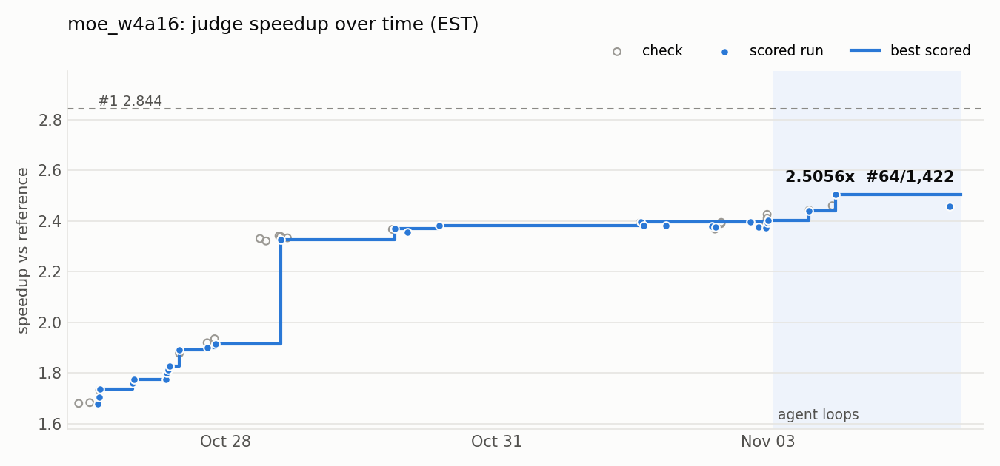
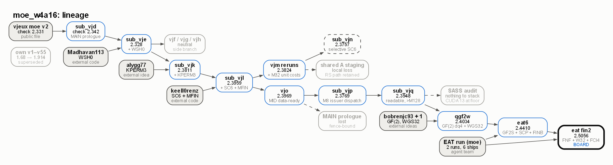

# moe_w4a16

| Metric | Value |
|---|---|
| Final speedup | **2.5056x** |
| Final rank | 64 of 1,422 (top 4.5%) |
| Best rank held during the track | #47 (2026-11-03) |
| Board leader | 2.844x |
| Scored runs / checks | 29 / 22 |
| Final file | EAT MoE run 2 final ("fin2") |
| EAT | Evolving Agent Teams: autonomous agent loop (method from caoshiyi/EAT, Apache-2.0), paired H200 A/B as ship gate |

## Score history

"check" = unscored judge run, "scored" = counted run; bold = new best scored row. bs / M = tokens per call.

| Date (UTC) | Version | Judge | What changed |
|---|---|---|---|
| 2026-10-26 | first own kernel | check 1.6800, scored **1.6782** | two persistent CUDA GEMM kernels (TMA weight ring + producer warp, NVFP4->bf16 dequant in registers, mma.sync; wgmma above bs 96) + combine, PDL-chained |
| 2026-10-26 | v6 | scored **1.7363** | own tuning rounds (1.7037 scored in between); A/B baseline for later steps |
| 2026-10-27 | v7 | scored **1.7596** | topk ids staged in the idle ring before routing; GEMM1 zeroes only the local y rows |
| 2026-10-27 | v8 | scored **1.7755** | `__launch_bounds__(160, 3)`: 3 CTAs/SM on the wgmma kernels |
| 2026-10-27 | v9 | scored 1.7738 | 3 ring stages at bs ≤ 4, ksplit 1 at bs 5-8 (= v8 within noise) |
| 2026-10-27 | v10 | scored **1.8007** | ksplit 1 for all bs 5-32 |
| 2026-10-27 | v12 | scored **1.8135** | activations gathered by TMA on the wgmma path above bs 160 |
| 2026-10-27 | v13 | scored **1.8272** | retune: bs 17-32 nt 2 / ksplit 1 / 2 stages; cost_a 12 above bs 160 |
| 2026-10-27 | v27 | check 1.8778, scored **1.8904** | split-row-block roles: finisher reads early, contributors `red.global.add.v4` + `red.release` count |
| 2026-10-28 | v45 | check 1.9197, scored **1.9011** | compile-time k-step trip count, no bounds test on tile 0 |
| 2026-10-28 | v55 | check 1.9353, scored **1.9144** | dynamic 16-chunk work pieces in the bs > 160 kernels; last own-kernel row |
| 2026-10-28 | vjeux v2 (public) | check 2.3311 | public Apache-2.0 file, unmodified: one persistent kernel, in-kernel routing, RS-wgmma stream-K; replaced the own line |
| 2026-10-28 | vj5 | check 2.3215 | MID build at bs 17-32: +2.7% on Modal, -7% at bs 32 on the judge |
| 2026-10-28 | vjd | check 2.3415 | cleanups (state 1.8 GB instead of 3.6 GB) + shorter MAIN-build prologue |
| 2026-10-28 | vje | check 2.3395, scored **2.3281** | + WSH0: MID helper warp = hardware warp 0 (Madhavan113) |
| 2026-10-28 | vjf | check 2.3340 | FGRP aligned stage ranges: fewer DRAM bytes, same time; not kept |
| 2026-10-30 | vjk | check 2.3674, scored **2.3715** | + KPERM: K permuted inside each 256-K stage (alygg77 idea, own code) |
| 2026-10-30 | vjk re-rolls | scored 2.3559, **2.3811** | same code + one comment |
| 2026-11-01 | vjl | check 2.3933, scored **2.3959** | + SC6 exact 6-bit block scales + MFIN per-expert readiness instead of the grid barrier (keell0renz) |
| 2026-11-01 | vjm (3 rolls) | scored 2.3809, 2.3824, 2.3782 | M32-only per-unit stage costs; retest -0.1%, dropped |
| 2026-11-02 | vjn | check 2.3686, scored 2.3757 | plain-scale MAIN bank above M 128 (+864 MiB) |
| 2026-11-02 | vjo | checks 2.3901, 2.3949 | + MID data-ready hand-off at 9-16 tokens (keell0renz) |
| 2026-11-03 | vjo | scored **2.3969** | same file, scored |
| 2026-11-03 | vjp | scored 2.3769 | + M8 on the issuer-warp build (low roll: bs 16 101 vs 95 us) |
| 2026-11-03 | vjor | check 2.3911, scored 2.3742 | readable rewrite of vjo (embedded zlib+base64 blob replaced by plain source) |
| 2026-11-03 | vjq | check 2.3873, scored 2.3948 | readable vjp + plain-scale MAIN above M 128 + issuer warp also at M7 |
| 2026-11-03 | qgf2a | check 2.4120 | + GF(2) re-layout of the 4-bit code words (MAIN only) |
| 2026-11-03 | qgf2w | check 2.4268, scored **2.4034** | + GF(2) re-layout + WGS32 build for M 17-32 |
| 2026-11-03 | eat6 (EAT run 1) | check 2.4428, scored **2.4410** | GF2S, MID8, SCP, FINB, EPF, BHOLD, MIDNH, MID5, NOPLAIN; 7 builds -> 4, judge prepare 245 -> 140 s |
| 2026-11-03 | fin2 (EAT run 2) | check 2.4608, scored **2.5056** | + FNF, W32T, W32 A3, FCI4, BHOLD1, MIDNH1, PM-B8, W32R0 (high roll vs its check) |
| 2026-11-05 | fin2 re-roll | scored 2.4584 | same code + one comment |

## What's in the final file

| Component | Source |
|---|---|
| One persistent kernel: redundant in-kernel routing, phase A (gate/up + SwiGLU), phase B (down + sum of squares), final RMS-norm pass; TINY / MID / MAIN builds picked by M; RS-wgmma stream-K MAIN; DQ7 dequant, PRMT scale decode | vjeux/okc-2026 v2 (Apache-2.0) |
| Cleanups: diagnostics and two unread weight layouts removed (state 1.8 GB instead of 3.6 GB) | own |
| Shorter MAIN prologue: route reuse of ranks, jrow, stage ranges on the whole x-producer warp, binary-search gather walk, weight producer waits for the first x copy | own |
| WSH0: MID helper warp = hardware warp 0 | Madhavan113/kerneloptimizer (Apache-2.0) |
| KPERM: K permuted per 256-K stage so each lane loads and builds its scales once per stage | idea from alygg77 (Apache-2.0), own reimplementation |
| SC6: exact 6-bit storage of the FP8 block-scale bytes, original format as fallback | keell0renz (Apache-2.0), adapted |
| MFIN: per-expert completion counters instead of the final grid barrier, plus an empty-work guard | keell0renz, adapted; guard own |
| MID data-ready (DF) hand-off, now serving M 5-16 | keell0renz, adapted |
| GF(2) code-word layout: invertible XOR-linear map of each 32-bit word in prepare, 8 instructions per 8 codes instead of 9, bit-exact over all 2^32 words; MAIN (GF2) and small builds (GF2S) | idea from bobrenjc93's write-up (no code), own derivation by exhaustive search |
| WGS32: MAIN-family build with FT_T = 32 for M 17-32 | Madhavan113/ParadigmKernelChallenge (Apache-2.0) |
| SCP: small builds decode one bf16x2 scale pair per 64-K chunk | own (EAT run 1) |
| FINB / EPF / BHOLD: batched MAIN final pass, epilogue constants before the drain, producer holds early phase-B stages | own (EAT run 1) |
| MIDNH / MID8 / MID5 / NOPLAIN: L2 policy for split MID experts, M 5-16 on MID, SC6 bank at every M; 4 builds total | own (EAT run 1) |
| FNF: one `fence.acq_rel.gpu` dropped from the WGS finisher (CUTLASS stream-K ordering) | own (EAT run 2) |
| W32T / W32 A3 / W32R0: WGS32 phase-A cost table and unit-order start | own (EAT run 2) |
| FCI4 + BHOLD1 / PM-B8 / MIDNH1: deferred-flush timing, second cost table above M 192, refined MID cache hint | own (EAT run 2) |
| EAT loop itself (supervisor session reorganizes up to 3 coding agents per iteration) | caoshiyi/EAT method (Apache-2.0), no kernel code |

## What worked

| Lever | Measured gain |
|---|---|
| topk ids staged in the idle ring (own kernel) | +1.8% geomean; routing 5.7 -> 3.7 us at bs 128 |
| GEMM1 zeroes only local y rows | +1.4% (+2% at bs 128/256) |
| 3 CTAs/SM on the wgmma kernels | +4.7% bs 128, +2% bs 256 |
| ksplit 1 at bs 16 / 32 | +2.9% / +4.8% |
| TMA-gathered activations above bs 160 | +5.9% at bs 256 |
| `red.global.add.v4` partials + `red.release` count (v27) | +5.5% geomean over bs 1-32 |
| compile-time k-step trip count (v45) | +1.2-2.0% at every mma shape |
| Switch to the vjeux v2 public base | judge check 1.9353 (v55) -> 2.3311 |
| Shorter MAIN prologue | +0.7 / +0.4 / +0.1% at bs 32 / 128 / 256 |
| WSH0 | bs 16 -2.0..-2.5 us |
| KPERM | +2.2-2.4% pooled at bs 32-256, 108/108 cells; PRMT 1154 -> 386 |
| SC6 + MFIN | +0.5-0.6% full score; bs 32 +1.7-1.95% |
| MID data-ready hand-off | M16 +1.805%, +0.299% six-load |
| GF(2) layout on MAIN | M32 +1.09%, M128 +1.53%, M256 +1.29%; six-load +0.65% |
| WGS32 build | M32 +2.61% (with GF2); qgf2w +0.90% over vjq |
| EAT run 1 ships (cumulative vs qgf2w) | GF2S 1.0043 -> MID8 1.0060 -> SCP 1.0085 -> FINB+EPF+BHOLD 1.0132 -> MIDNH+MID5+NOPLAIN 1.0155 |
| EAT run 2 (fin2 vs eat6) | 1.0032; MAIN d32 +1.4%, v32 +0.5%; FNF alone ~+0.24% six-load |

## Dead ends

| Idea | Result / why it lost |
|---|---|
| Fused GEMM1+GEMM2 kernel (v16-v22) | v16 +1.8% bs 1 only; every pipelined form lost 15-60% (a fence under a saturated stream costs ~5 us) |
| Slab-fused kernel (v40) | 0.80-0.93x at bs 1, 0.87-0.92x at bs 8-32 |
| Cluster launch for DSMEM balancing | cl 4/8: -4-5% at bs 1-32, -20-24% at bs 128/256 (fewer resident CTAs) |
| Runtime work moving: donation, dynamic pieces (v51), skew (v43), merged CTA (v53) | 0.85-0.97x, 0.925-1.004 except bs 256, -2-8%, 0.80-0.98x: per-SM throughput is the limit |
| SM-aware static partition | stable per-SM spread only ±2%; -1-4% at bs 1-32 |
| Deferred ring-slot release on wgmma (v15) | 13% slower at bs 128/256 (ptxas scheduling) |
| L2 prefetch of GEMM2 chunks | -6..-18%; prefetched lines evicted before use |
| Cheaper dequant: 8-op decode (v49), IMAD.WIDE rotates (v50) | 1.001x / 0.97x |
| Fence-free sentinel split protocol (v30) | 0.984x |
| Fast warp-level routing on v45 | bs 1 0.94-0.97 |
| MID build at bs 17-32 (vj5) | +2.7% on Modal, -7% at bs 32 on the judge (Modal seeds route heavier) |
| WPEARLY / bf16 ybuf / sum of squares in epilogue | 0.995 / 0.992 / 1.004 |
| Steeper or flatter WGS cost tables | -3.5% to -27%: the tuned table is a sharp optimum |
| Deeper skinny ring (NS 4/5) | 0.970 / 0.945 |
| Phase A->B credit variants (ACR, per-unit release, reversed walk) | 0.875-0.995 |
| FGRP: no re-stream of >64-token experts | DRAM 618 -> 550 MB at bs 256, time flat (check 2.334); consumer-bound |
| 128x128 wide unit for fat experts | -4-14% at bs 256 |
| Larger-N expert engine (SSE / RS128) | ceiling 4-6% at bs 256, ≤1% at bs 128; 96-register wall at 576 threads |
| Phase-B weights resident in smem at bs 1 (BRES) | -4-8%; code presence alone -3.3% |
| Shared-memory staging of dequantized A (SS wgmma) | 1.61-2.88x slower than RS |
| M32-only unit-cost scheduler (vjm) | retest -0.1%; 3 scored rolls 2.3782-2.3824 |
| Earlier MAIN weight TMA, direct x fills, L2 prefetch of first stages | -0.5..-3%: the gather's release fence waits for in-flight TMA |
| SASS clean-up of descriptor rebuilds | absent under the judge's CUDA 13.0; a "fix" made it worse (304 -> 318 instr per stage) |
| M1-8 all on the issuer-warp build (WSIALL) | 0.9894 at decode 1 |
| M16 on the WGS32 build | 0.9453 |
| EVICT_NORMAL for split MAIN experts (SIB6) | 0.9970 at verify 16 |
| Plain-scale bank at bs 128 under judge routing | 0.9920; the plain bank was then dropped (NOPLAIN) |
| Expert-sliced TINY order (XSL) | +3.38 us at bs 1 |
| Refill-address table in TINY (RAT) | +1.03 us at bs 1 |
| Release warp for consumer fences (RELW) | spills in MAIN, device fault on first launch |

## Lessons

- Switching to the strongest public base early was worth more than three days of own tuning (1.914 -> 2.328).
- Modal default seeds route heavier than the judge at bs 8/32; a Modal "keeper" lost 7% on the judge.
- Code that is compiled in but unused can cost 3-5% through ptxas; always measure with the feature off too.
- On a streaming SM any gpu-scope release waits for the in-flight TMA bytes; handshakes are the real cost, not math.
- Moving work between CTAs at runtime never paid; the per-SM tail is structural.
- Identical code rolls about ±1-2% on the judge (fin2: check 2.4608, scored 2.5056, re-roll 2.4584).
