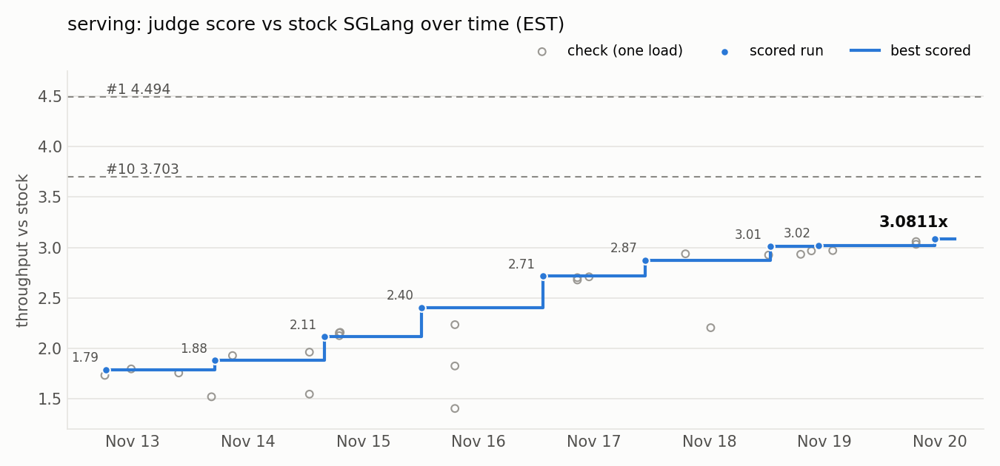
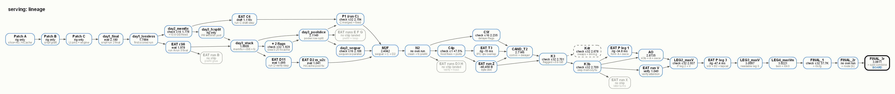

# Serving track

| Metric | Value |
|---|---|
| Final score | **3.0811x** stock SGLang (1 / 4 / 16 / 32 users: 3.106 / 3.094 / 3.099 / 3.027x) |
| Scored runs / checks | 9 / 25 (1 check timed out on the judge side) |
| Base | SGLang `297e54fd`, Muse Spark Open 816B-A42B NVFP4 + DFlash2 drafter |
| Hardware | 8 x H200, TP8 = EP8 |
| Rules | lossless; 1 scored run + 3 checks per day; open 2026-11-12, closed 2026-11-20 00:00 PT |
| Final gates | prefill KL 0.053, decode KL 0.012, later-turn agreement 0.95-0.97, memory -2.2 GB vs stock |
| Board on 2026-11-20 | #1 4.494x, #10 3.703x |
| Files | [FINAL_3r.diff](FINAL_3r.diff), [flags](flags), [FINAL_3r.notes.md](FINAL_3r.notes.md) (reviewer notes: every part in detail) |

## Score history

| Date (EST) | Score | Step | New vs the previous scored run |
|---|---|---|---|
| 2026-11-12 | 1.7884 | | Lossless form of the pre-open patch: own Hopper NVFP4 MoE kernels (prefill + verify engine, Marlin replaced), pooler / unpooler slices at verify, HiCache staging, cuBLASLt pins; stock FA3 and stock SiLU. 16-user load capped (later-turn TTFT 0.95 s > 2x stock) |
| 2026-11-13 | 1.8809 | +5.2% | Memory fix (+13.6 GB/GPU back to the KV pool, cap gone); run A prefill tree; DFlash fc split across TP |
| 2026-11-14 | 2.1149 | +12.4% | Pooler / unpooler row split at prefill + all-gather; flags `--swa-full-tokens-ratio 0.25 --hicache-size 120` |
| 2026-11-15 | 2.4042 | +13.7% | Sequence-parallel prefill after attention; run C draft step; run D2 verify step |
| 2026-11-16 | 2.7146 | +12.9% | Rules cleanup (FA3 split cap out, seq-par from 2,304 rows); fc split at prefill; first-turn ports (route rows, stock layers 0 / 61, K/V gather); host fixes; streamed o; copy-engine qkv (run T); prefill delayer flags |
| 2026-11-17 | 2.8735 | +5.9% | Byte diet (run Z); last layer on read rows only; FA3 split cap back (ruled OK); per-forward hot-expert copies (form A); o-weight copy-engine prefetch |
| 2026-11-18 | 3.0097 | +4.7% | Run P legs 2-3: form A planner tuning, streamed-o pushes, lean tap / exit gathers, stock layer 0 on the seq-par path, form A from 4,096 rows, drafter tap pack; run V verify attention |
| 2026-11-18 | 3.0221 | +0.4% | Layer-0 fp32 cast + RMSNorm in two passes (bitwise); diff stripped of whitespace, comments and 75 private names (renames ruled out on 2026-11-19) |
| 2026-11-19 | **3.0811** | +2.0% | Layer-0 experts: large-row tile config for stock's Triton kernel; experts' reduce-scatter written into the token owner's inbox (route (b)); owner combine as two kernels; readable again (no renamed names) |

| Date (EST) | 1 user | 4 users | 16 users | 32 users | c32 tok/s/GPU |
|---|---|---|---|---|---|
| 2026-11-12 | 1.912 | 1.763 | 1.752 | 1.732 | 21,991 |
| 2026-11-13 | 1.942 | 1.885 | 1.886 | 1.812 | 23,104 |
| 2026-11-14 | 2.060 | 2.071 | 2.197 | 2.135 | 27,047 |
| 2026-11-15 | 2.468 | 2.348 | 2.432 | 2.370 | 29,921 |
| 2026-11-16 | 2.762 | 2.681 | 2.751 | 2.666 | 33,840 |
| 2026-11-17 | 2.852 | 2.871 | 2.928 | 2.844 | 36,043 |
| 2026-11-18 | 2.961 | 3.017 | 3.075 | 2.987 | 37,849 |
| 2026-11-18 | 3.012 | 3.019 | 3.077 | 2.981 | 37,842 |
| 2026-11-19 | 3.106 | 3.094 | 3.099 | 3.027 | 38,185 |

## Checks

| Date (EST) | Users | Rung vs stock, same node | Tested -> reading |
|---|---|---|---|
| 2026-11-12 | 16 | 1.733 | First lossless patch -> later-turn TTFT over the cap |
| 2026-11-12 | 16 | 1.778 | Memory fix -> weights 83.4 -> 70.5 GB, token capacity 1.17M -> 1.91M, cap gone |
| 2026-11-13 | 16 | 1.745 | Run A prefill tree alone -> inside noise, still capped |
| 2026-11-13 | 1 | 1.550 | Day-3 stack (memory fix + run A + fc split) -> +0.6% at 1 user, inside noise |
| 2026-11-13 | 32 | 1.929 | Day-3 stack + 2 flags -> +6.5%, later-turn TTFT 1.51 -> 0.63 s |
| 2026-11-14 | 16 | - | Pooler row split + flags -> timed out on the judge, slot refunded |
| 2026-11-14 | 16 | 1.963 | Pooler row split -> +9.5%, first-turn TTFT -13% |
| 2026-11-14 | 1 | 1.557 | Run D verify tree -> +1.4..3.7% per-user, inside 1-user noise |
| 2026-11-14 | 32 | 2.154 | Run C draft step + path log -> safe on real weights, gain inside noise |
| 2026-11-14 | 16 | 2.108 | Sequence-parallel prefill -> +7.8%, first-turn TTFT -13% |
| 2026-11-14 | 32 | 2.159 | Run D2 verify store + path log -> path runs on all 8 ranks |
| 2026-11-15 | 1 | 1.831 | Host fixes + prompt lookup + 4 first-turn ports -> first turn -209 ms; acceptance 4.2, lookup dropped |
| 2026-11-15 | 1 | 1.390 | Accepted tokens capped at 4 + routing probe -> acceptance 3.0 (geometric tail): wide verify closed; rank imbalance 1.61-1.65 |
| 2026-11-15 | 16 | 2.235 | Prefill delayer flags -> +2.4%, later-turn TTFT 1.30x stock |
| 2026-11-16 | 32 | 2.701 | Stack K3 (diet + comm + last-layer skip + FA3 cap) -> flagged: +3.6 GB over stock |
| 2026-11-16 | 32 | 2.678 | K3 + expert swaps from a probe text + timing lines -> imbalance real (62 of 433.5 ms per chunk), swaps gain nothing |
| 2026-11-16 | 32 | 2.709 | K3b (skip memory fix) -> 0.4 GB under stock |
| 2026-11-17 | 32 | 2.937 | Run P leg 2 + run V kernel -> +2.9% over the 2.8735 file |
| 2026-11-18 | 4 | 2.177 | Real-routing skew lines (server slowed by the profiler) -> 25.6 ms spread at 5,267 rows: form A from 4,096 rows |
| 2026-11-18 | 32 | 2.925 | Leg 3 + residual-imbalance lines -> 1.097 after form A vs 1.027 oracle: ~49 ms left |
| 2026-11-18 | 32 | 2.932 | Layer-0 norm build + acceptance lines -> lines lost (server reported ready mid-drive) |
| 2026-11-18 | 32 | 2.966 | Same, readiness held -> no warm-path acceptance loss |
| 2026-11-19 | 32 | 2.969 | + layer-0 tile config + DP-walk census -> DP walk +0.0125 tokens/step: killed |
| 2026-11-19 | 32 | 3.031 | FINAL_3r (readable, 1 row of diff context) -> 38,671 tok/s/GPU, every gate |
| 2026-11-19 | 32 | 3.058 | FINAL_3r content, normal diff packaging -> 38,697 tok/s/GPU |

## Where the time goes

| Users | First-turn prefill (first scored run) | Later-turn extends | Verify / decode | +1% on this rung = score (2026-11-17 curve) |
|---|---|---|---|---|
| 1 | 32% | 12% | 55% | +0.10% |
| 4 | 40% | 8% | 52% | +0.43% |
| 16 | 50% | 12% | 38% | +0.27% |
| 32 | 57% | 26% | 17% | +0.50% |

| Phase | Bound by | Distance from floor | +1% faster = score |
|---|---|---|---|
| First-turn GEMMs + expert kernel | 700 W power cap | 93-106% of floor; expert kernel 680 TF/s at 692 W | 0.73% (whole first turn) |
| First-turn attention (stock FA3) | exp unit throughput | 55-58% of the MUFU limit; stock kernel kept | in first turn |
| First-turn collectives | NVLink | 738 ms per rank = 28% of a first turn, at 51-73% of link (2026-11-14 base) | in first turn |
| First-turn expert imbalance | slowest rank at the reduce-scatter | 62 of 433.5 ms per 16K chunk before form A; max/mean 1.097 after, oracle 1.027 | in first turn |
| Later-turn extend (753 rows) | fixed cost per forward | 63-78 ms fixed + 47-61 µs per token (62 layers, 8 GPUs) | 0.22% |
| Verify step | HBM bytes + launches | cycle ~2x its byte floor; FA3 at 38-48% of floor | 0.44% |
| Draft step | HBM bytes | - | 0.03% |
| Host / scheduler | | kernels busy 98% of the 32-user run, 94% at 1 user | |

| Time model | Score |
|---|---|
| Base: first turn ~2.0 s, extend ~88 ms, 1-user cycle 10.9 ms | 3.009x |
| Realistic lossless: first ~1.7 s, extend 65 ms, verify x0.9-0.95 | 3.6-3.9x |
| Lossless physical: first turn 1.40 s, verify at its byte floor | ~5.3-5.7x |
| FP8 GEMMs (not allowed) | ~8.7x |

## Patch parts

Details, switches and fallbacks per part: [FINAL_3r.notes.md](FINAL_3r.notes.md).

| Part | Class | Rough gain |
|---|---|---|
| Hopper NVFP4 expert kernels (prefill fused MoE; verify engine at <= 384 rows) instead of Marlin | stock's W4A16 math; row order inside an expert varies run to run (<= 1 bf16 ulp) | prefill layer ~1.92x stock per layer (one-GPU eval) |
| Memory fix: one `empty_cache()` before the expert repack | no numerics | 12.9 GiB/GPU unstranded; most of 2026-11-13's +5.2% |
| Pooler / unpooler row split at prefill + all-gather | order-only | +9.5% at 16 users |
| Sequence-parallel post-attention, layers 0-60 (o-proj reduce-scatter, norms, router, pooler, experts, unpooler on T/8 rows) | order-only | +7.8% at 16 users, first-turn TTFT -13% |
| Copy-engine transports over CUDA IPC: next layer's qkv input, streamed attention output, next o weight | bitwise | qkv ~-110 judge ms per first turn (est.) |
| Per-forward hot-expert copies on lightly loaded ranks (form A) | bitwise | with the o prefetch ~-129 judge ms per first turn (32-user TTFT 64.35 -> 60.61 s) |
| Experts' reduce-scatter written into the owner's inbox (route (b)) + two-kernel combine | order-only (fixed ring-order sum) | -2.5..-7.4 rig ms, then -1.7 rig ms |
| Last layer: only rows the logits processor reads | skips unread rows (ruled OK) | -56.6 rig ms per first turn |
| Layer 0: seq-par path, two-pass norm, large-row tile config | bitwise / order-only | -9.7 and -8.3..-12.7 rig ms |
| DFlash fc split (verify + prefill), drafter tap pack, run C draft kernels | bitwise | prefill -70 ms per 74K first turn (8-GPU rig); draft cycle 1.118x |
| Verify: runs D / D2 fused q/k norm + RoPE + FP8 K/V store, router split, skinny engine | bitwise / order-only | 1.095x verify step (one GPU); store path +4.4% of the step at 32 users |
| Verify attention: FA3-exact kernel, other split count (run V) | split plan (ruled OK) | +0.6% throughput at 16 / 32 users (8 GPUs) |
| Host fixes (ids check, shared-memory scheduler collectives) | no numerics | small-request fixed cost 66.7 -> 47.5 ms |
| Flags `--swa-full-tokens-ratio 0.25 --hicache-size 120` | stock options | +6.5% at 32 users |
| Flags: prefill delayer 0.375 / 6 passes, `--prefill-max-requests 32` | stock options | +2.4% at 16 users |

## Dev pipeline

| Environment | Purpose |
|---|---|
| Patch lint | size cap, 400-char lines, forbidden words, applies on `297e54fd` |
| Dummy-model rig (5 layers, 1-2 H200) | boot, stock vs patched step at 1 / 4 users, 20K TTFT, KV tokens; 3-min CPU import mode |
| One-GPU probes in the judge image | single questions: allocator stranding, NaN rows, tile configs, bitwise checks |
| Soak harness | 3.43M replays, 364 tests x 10k, 7 modes; tiny-T sweep under compute-sanitizer |
| wgmma hazard scan | SASS scan for the CUDA 13.0 register-input wgmma miscompile, every new kernel |
| 10-layer rig, 8 GPUs | 74K first turn timed per boot, rank agreement over 145 records, memory in logprob phases, smoke, 1-user step |
| 62-layer rig, 8 GPUs, closed loop at 16 / 32 users | judge-shaped later turns; reproduces the judge's 32-user rung within 0.5% |
| Modal H200 | 1-2 GPU rigs and evals; 8xH200 sessions (2026-11-14/15, fallback later); gVisor hosts refuse graph updates until `SGLANG_ENABLE_CUDA_GRAPH_DEDUP=0` |
| Nebius spot 1 x H200 | rig and agent-loop evals first, Modal as fallback |
| Nebius spot 8 x H200 | 8-GPU sessions from 2026-11-16; idle auto-stop; preemptions and no-node bursts |
| Judge check | real weights and workload, one load, 1 rep (3 at 1 / 4 users) |
| Test-only startup lines | judge-side readings through a check: paths taken, per-rank timing, skew, acceptance |
| Tracker | judge API pull, per-load progression, lineage graph |

Agent-loop runs ([AUTORESEARCH.md](../AUTORESEARCH.md)):

| Run | Target | Outcome |
|---|---|---|
| A | prefill layer, one-GPU eval (3 runs) | run 2 2.180x, lossy, dropped; run 3 1.978x vs stock, in the 2026-11-13 stack |
| B | prefill glue + GEMMs | no ship (0.99996 vs A) |
| C | DFlash draft step | 1.118x draft cycle, in the 2026-11-15 stack |
| D | verify step | 1.095x on a plain KV pool; ~3.4 points dead on the judge's SWA pool |
| D2 | verify step on the judge's pool type | 1.041x over D, in the 2026-11-15 stack |
| D3 | verify step, order-only gate | +1.04% of a verify step for +26 KB: not shipped |
| E | prefill layer, corrected eval | no ship (16K path at the power cap) |
| F | served loop, delayer policy | +0.2%: not shipped |
| G | extends under 2,048 rows | ~+0.1% of wall: not shipped |
| H | host path | no ship |
| T | cross-GPU comm, scored on 8-GPU sessions | copy-engine qkv over IPC, in the 2026-11-16 stack |
| Z | patch byte diet | -40,450 B, bitwise; base of the 2026-11-17 stack |
| V | verify attention, split count free | 1.049x verify stack, in the 2026-11-18 stack |
| X | later turns at 16 / 32 users | no ship: rig GPU-bound, no lever reached 0.3% |
| P | first turn on 3-boot 8-GPU sessions, legs 1-5 + final climb (iterations 1-62) | every scored file from 2026-11-17 on |

## Dead ends

| Idea | Result |
|---|---|
| Own FP8 prefill attention + tanh SiLU (pre-open, 2.180x per layer) | failed the 2026-11-11 lossless rule; ~0.2x of the per-layer eval lost with it |
| Finalize + all-reduce fusion on Hopper | ceiling 0.88%, realistic ~0.3%: closed at the estimate |
| Prompt lookup / n-gram drafting | built; acceptance 4.2 vs the 4.4 bar: dropped |
| Wider verify (16 / 32 tokens + second drafter block) | acceptance is a geometric tail (3.0 under a cap of 4): closed |
| Expected-accept DP walk over the drafter's candidates | +0.0125 tokens per step on real weights vs +0.10 bar |
| Expert sharding across GPUs (ruled OK) | FP32 per-routed-row traffic 16x today's: +1.7..2.3 s per first turn |
| `--enable-eplb` | crashes this model at boot |
| Static expert swaps planned from a fixed text | real imbalance, no end-to-end gain: plan does not carry to served traffic |
| Expert re-plan from served traffic (form B, ruled OK) | -1.6 rig ms with a one-off 0.7-1.7 s stall: predicted loss at 32 users |
| NCCL settings (CTAs, LL128, forced NVLS) | not resolvable in situ / -3..-7% / -19..-24% |
| Torch symmetric-memory copy-engine qkv | hung at boot; replaced by CUDA IPC |
| Two row groups + copy-engine gathers | 0.5093 vs 0.5060 s: no gain |
| Pooled-row start under the expert kernel | predicted +6..+10 rig ms (loss) |
| Reduce-scatter as per-owner pushes | +2.0 and +8.0 rig ms (slower) |
| Two 16K micro-batches in flight | -3.5 rig ms vs +17..+20 predicted: the split adds 9 NCCL ops per instance |
| 32K prefill chunks | prefill graph pool 13.3 -> 26.1 GB, -1.25M KV tokens |
| 24,576-row chunks with an eager fast path | eager peak 7.30 GB vs 4.2-4.7 GB of room |
| Fused extend + verify forward | saves nothing at the judge's shapes |
| `--enable-mixed-chunk` | loss at every load (DFlash treats mixed batches as prefill) |
| `--page-size 64` / XQA decode attention | kills the prefill fast path (-20..-25%) |
| DP attention | replicates 27 GB, far slower |
| `--mem-fraction-static 0.87` | -0.04%: the KV pool never binds at 32 users |
| `--min-free-slots-delay 8` | +0.24% throughput, later-turn TTFT p90 0.76 -> 1.10 s |
| Prefill delayer pass cap 2 / 3 / 10 / 16 | 6 (shipped) on the plateau |
| Custom all-reduce cap 16 -> 32 MB | -1.2% throughput at 16 users |
| Pooler slicing on 768-row extends | loss (break-even 850-900 rows) |
| L2 prefetch off in the prefill expert kernel | 0.1-1.4% slower |
| Fused all-reduce + residual + RMSNorm at verify | stock kernel does not fit Muse's layer boundary; new kernel ceiling +0.2% |
| Custom verify attention on FA3's own split plan | 15-21% slower than FA3 |
| Polynomial exp2 (ruled OK) | slower than the hardware instruction |
| Run D's FA3 one-wave split cap | lowered the split count, raised attention error: removed until run V's version |
| Combine v2 / v3 variants, rider bundle | +2.70 / +0.9 rig ms; 1-user step +0.27 ms |
| Renamed private identifiers to save bytes | ruled not readable on 2026-11-19; the 3.0221x run used them |

## Lessons

- Only the judge sees real weights and routing: rig estimates missed both ways (fc split 1.5-2.5% est. vs ~0.6%; comm and delayer landed above the rig).
- A single check resolves ~2% at 16 users, ~4.5% at 1 user; scored runs differ for real only above ~2.5-3.5%.
- A 32-user check under-reads the scored 32-user rung by ~1.5-2%.
- 8-GPU memory gates need logprob requests: the last-layer skip passed every rig session and was flagged +3.6 GB on the judge.
- Expert balance has to follow live routing; plans from other text do not carry over.
- Ask the organisers before building on a gray-zone reading; the readability ruling came on the last day.
